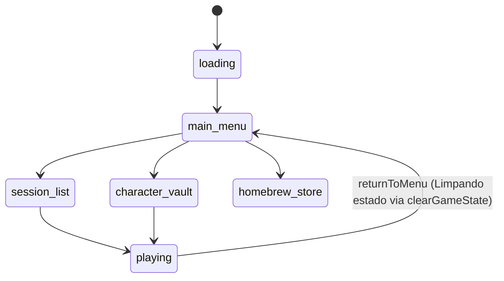
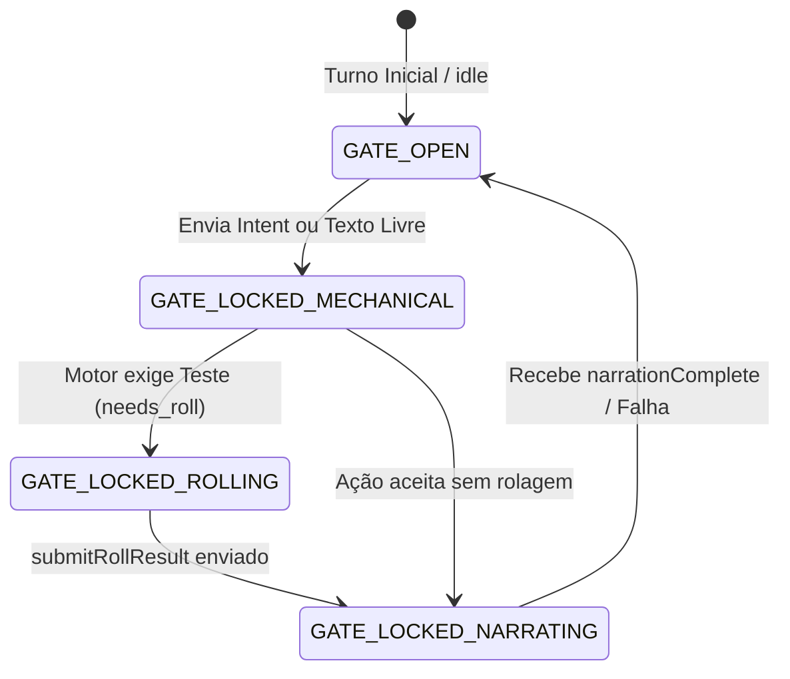

# Crônicas de Aventuras — Camada de Apresentação e Design Cinematográfico

> **Documento Canônico de Design e Frontend** (Revisão: Maio de 2026).  
> Este documento extingue qualquer arquitetura de coexistência legada ou chaves de transição (`NEXT_PUBLIC_UI_V2`).  
> O frontend foi completamente reestruturado sob as diretrizes estéticas e imersivas da Wizards of the Coast (WotC) combinadas ao dinamismo tático de Baldur's Gate 3 (BG3).

---

## 1. Princípios Fundamentais de Interface

| Princípio | Filosofia de Implementação |
|-----------|----------------------------|
| **Imersão Editorial** | A interface deve evocar a sensação de um livro físico premium ou de uma tela de cinema, distanciando-se de painéis SaaS administrativos (cinzas e tabelados). |
| **Integridade Assíncrona** | O jogador visualiza números, barras e alterações de estado mecânico gerados pelo Motor síncrono antes do parágrafo de prosa da IA terminar de rodar no worker. |
| **InputGate Absoluto** | Bloqueio rígido de ações mecânicas com estado mutável enquanto o pipeline distribuído estiver fechando o turno (anti-spam de concorrência). |
| **Legibilidade em Contraste** | Textos longos usam tipografia orgânica serifada na cor pergaminho sobre fundos escuros profundos, minimizando a fadiga ocular. |

---

## 2. Sistema de Design Tokens (`src/design-system/`)

O ecossistema visual abandona paletas genéricas e adota um conjunto estrito de tokens de alta fantasia cinematográfica.

### 2.1 Paleta de Cores (Tailwind `dnd-*`)
```css
--dnd-obsidian: #050506;        /* Fundo absoluto do jogo (o breu das masmorras) */
--dnd-obsidian-raised: #0d0d12; /* Superfície de painéis, sidebars e cards elevados */
--dnd-obsidian-tint: #16161f;   /* Estados de hover em listas e itens selecionáveis */
--dnd-ember: #e40712;           /* Vermelho WotC acentuado (foco, perigo, CTAs críticos) */
--dnd-ember-hover: #ff2430;     /* Brilho de chama ativa (estados interativos) */
--dnd-ember-deep: #9b0610;      /* Sangue/Ember escuro (estados de clique/pressed) */
--dnd-gold: #d4af37;            /* Ouro envelhecido (bordas finas, runas, títulos e divisores) */
--dnd-gold-bright: #f0d878;     /* Luz dourada (hover em itens mágicos e recompensas) */
--dnd-parchment: #f7f0e3;        /* Cor principal de leitura para prosa e logs narrativos */
--dnd-parchment-muted: #b8a88c;  /* Metadados, tags de sistema e descrições secundárias */
--dnd-success: #2d8a4e;         /* Indicadores de cura e rolagens bem-sucedidas */

```

### 2.2 Tipografia de Identidade

* **`font-display` (`--font-display`):** *Cinzel Decorative* / Serifada Display de Alto Impacto. Exclusiva para manchetes de Hub, títulos de masmorras e avisos táticos de combate.
* **`font-narrative` (`--font-narrative`):** *IM Fell English* / Letra orgânica de crônica. Usada com exclusividade na renderização das respostas textuais do Mestre Virtual.
* **`font-ui` (`--font-ui`):** *Inter* / Sans-serif geométrica limpa. Usada em modificadores de atributos, números de HP, labels de inventário e formulários internos.

### 2.3 Efeitos e Atmosfera Base

Aplicados no container raiz (`100dvh`) para moldar a profundidade de tela:

```css
.dnd-vignette {
  box-shadow: inset 0 0 120px rgba(0, 0, 0, 0.9);
}
.dnd-ambient-radial {
  background: radial-gradient(circle at 50% 30%, #161216 0%, #050506 100%);
}

```

---

## 3. Arquitetura de Navegação (`GameStage`)

O fluxo de telas é controlado centralmente no `GameContainer`, eliminando rotas dispersas e menus flutuantes.



---

## 4. Layout Gameplay: O `GameplayShell`

O design de jogo adota uma composição em três blocos rígidos no desktop (`lg+`), reorganizando-se em abas dinâmicas com dock flutuante no mobile.

```
┌────────────────────────────────────────────────────────────┐
│ GameplayTopBar — [Região/POI] | Clima | TTS | Menu Botão   │
├──────────────────────────────┬─────────────────────────────┤
│ [CombatTracker Tracker]      │  Side Panel (Abas)          │
│                              │  [Ficha] [Inv] [Mapa]       │
│  NewNarrativeLog (Scroll)    │                             │
│                              │                             │
│                              │                             │
│  GameplayActionDock          │                             │
└──────────────────────────────┴─────────────────────────────┘

```

### 4.1 GameplayTopBar

Exibe de forma estática o nome da Região atual com o token `dnd-gold`, o relógio mecânico do mundo, botões rápidos de controle de volume da trilha ambiente e configurações de sintetizador de voz (TTS).

### 4.2 NewNarrativeLog

Coluna central de rolagem infinita. As mensagens do tipo `narration` e `combat` utilizam a fonte de crônica sobre o fundo negro absoluto, criando separação visual imediata em relação aos boxes informativos de dados ou alterações táticas do sistema.

### 4.3 GameplaySidePanel

Painel lateral persistente que abriga abas densas para manipulação da ficha do herói, gerenciamento de slots de magia, equipagem de itens do inventário e renderização local do grafo de regiões vizinhas.

---

## 5. Pipeline Visual do Turno e o `InputGate`

Para impedir que ações rápidas do usuário enviem intenções mecânicas concorrentes ou poluam a fila assíncrona do BullMQ, a interface implementa um **InputGate** estrito de controle de barramento de ações.



### 5.1 Estados do InputGate

| Estado do Gate | Gatilho de Ativação | Comportamento da Interface |
| --- | --- | --- |
| **`GATE_OPEN`** | Estado `idle` no cliente, sem jobs em voo. | Permite digitação livre e cliques nos botões contextuais do dock. |
| **`LOCKED_MECHANICAL`** | Requisição enviada, aguardando validação do motor. | Desabilita todos os botões do dock e insere opacidade na caixa de texto. |
| **`LOCKED_ROLLING`** | Servidor retorna status `needs_roll` com `playerRollRequest`. | Abre o `DiceRollModal` com os dados 3D na tela. Bloqueia a digitação do chat até o dado ser lançado. |
| **`LOCKED_NARRATING`** | Servidor confirma `narrationQueued` via WebSocket. | Exibe o componente `LoadingOracle` informando que o motor concluiu a mecânica e a narrativa está sendo costurada. Bloqueio absoluto de inputs de estado. |

### 5.2 Implementação do Componente do Dock (`GameplayActionDock.tsx`)

```tsx
import React from "react";
import { useTurnPipeline } from "@/hooks/game/useTurnPipeline";

export const GameplayActionDock: React.FC = () => {
  const { turnPipelinePhase, actionPhaseLabel } = useTurnPipeline();
  
  // Hard-lock derivado diretamente do barramento de estado canônico
  const isLocked = turnPipelinePhase === "mechanical" || turnPipelinePhase === "narrating";

  return (
    <div className="relative w-full max-w-3xl mx-auto px-4 pb-6">
      
      {isLocked && (
        <div className="absolute inset-0 bg-dnd-obsidian/70 backdrop-blur-xs flex items-center justify-center border border-dnd-gold/10 z-50 rounded-sm">
          <div className="flex items-center gap-3 bg-dnd-obsidian-raised px-4 py-3 border border-dnd-ember/30 rounded-xs shadow-elevated animate-pulse">
            <div className="w-2 h-2 rounded-full bg-dnd-ember" />
            <span className="text-xs font-ui uppercase tracking-widest text-dnd-parchment font-bold">
              {turnPipelinePhase === "mechanical" 
                ? "Motor Computando Decisões..." 
                : `${actionPhaseLabel || "O Mestre está narrando..."}`}
            </span>
          </div>
        </div>
      )}

      
      <div className={`grid grid-cols-2 md:grid-cols-4 gap-2 transition-all duration-300 ${isLocked ? 'opacity-30 pointer-events-none filter blur-xs' : 'opacity-100'}`}>
        <ContextualActionButtons/>
      </div>
    </div>
  );
};

```

---

## 6. Sincronização e Ordenação com WebSocket (Invariante P4)

O frontend nunca confia na ordem cronológica de chegada de eventos de rede assíncronos. Mensagens do tipo `gameStateUpdate` e `narrationComplete` vindas do worker obrigatoriamente carregam o metadado `actionSequence`.

### 6.1 Tratamento de Mensagens com Filtro Antifrase Sênior

```ts
// src/hooks/game/useGameWebSocket.ts
import { useRef } from "react";
import { useTurnPipelineStore } from "@/hooks/game/turnPipelineStore";

export const useGameWebSocket = (onApplyValidatedState: (payload: any) => void) => {
  const latestActionSequenceRef = useRef<number>(0);
  const setPhase = useTurnPipelineStore((state) => state.setPhase);

  const handleIncomingMessage = (event: MessageEvent) => {
    const { type, payload } = JSON.parse(event.data);

    switch (type) {
      case "mechanicalStateUpdate":
        // Aplica imediatamente alteração de HP/Iniciativa na tela antes do texto da IA chegar
        applyMechanicalPatch(payload);
        break;

      case "narrationQueued":
        setPhase("narrating");
        break;

      case "gameStateUpdate":
        // Invariante P4.1: Descarta pacotes narrativos antigos/obsoletos vindos de retries ou rede instável
        if (payload.actionSequence < latestActionSequenceRef.current) {
          console.warn(`[WebSocket] Descartando frame narrativo obsoleto. Sequência recebida: ${payload.actionSequence}, Atual canônica: ${latestActionSequenceRef.current}`);
          return;
        }
        
        // Fixa a nova régua de sequência cronológica estável no cliente
        latestActionSequenceRef.current = payload.actionSequence;
        onApplyValidatedState(payload);
        break;

      case "narrationComplete":
        if (payload.actionSequence >= latestActionSequenceRef.current) {
          setPhase("idle"); // Libera o InputGate para a próxima ação
        }
        break;
        
      case "pendingRollState":
        // Mecanismo Heal: Reabre o modal de dados 3D se o usuário reconectar no meio de um teste pendente
        if (payload.playerRollRequest) {
          triggerRollModalHeal(payload.playerRollRequest);
        }
        break;
    }
  };

  return { handleIncomingMessage };
};

```

---

## 7. Componentes de Alta Performance Visual

### 7.1 DiceRollModal (Dados 3D)

Componente overlay fullscreen que invoca o `@3d-dice/dice-box`. Apaga os controles do chat e renderiza a física dos dados por cima do log. O botão de submissão do resultado é desabilitado após o clique, disparando a mensagem `submitRollResult` de forma atômica.

### 7.2 GameplayCombatTracker (O Trilho de Iniciativa)

Fixado de forma horizontal acima do log de narrativa. Exibe avatares compactos ordenados por valor de iniciativa. O combatente dono do turno atual ganha um contorno ativo de pulsação com o token `dnd-ember`, enquanto os combatentes mortos (`isDead: true`) são grayscale com opacidade reduzida.

### 7.3 Oficina Homebrew

Interface guiada (stepper dinâmico) estruturada de forma modular, permitindo a catalogação de itens, magias e raças diretamente nas definições formais da API 5e. Exibe de forma explícita uma badge de marcação de integridade do conteúdo (`original`, `translation` ou `fork`).

---

## 8. Diretrizes de Homologação de PRs no Frontend

Qualquer alteração ou nova funcionalidade inserida na camada de apresentação deve cumprir obrigatoriamente os seguintes critérios de aceite antes de avançar para a branch principal:

1. **Sem Chaves de Transição:** É proibida a adição de rotas legadas, componentes com nomenclatura `*Legacy` ou testes booleanos baseados em variáveis do tipo `NEXT_PUBLIC_UI_V2`.
2. **Isolamento Estrito de Tokens:** O componente React não deve injetar cores hexadecimais explícitas ou classes utilitárias de cores brutas do Tailwind (ex: `bg-red-600` ou `text-amber-500`). Deve-se utilizar exclusivamente a nomenclatura semântica `bg-dnd-ember` ou `text-dnd-gold`.
3. **Barramento de Ações:** Componentes interativos que modificam estado mecânico da sessão devem obrigatoriamente ler o hook do `InputGate` e travar a interação se a fase corrente for diferente de `idle`.

---

*Fim da especificação de design frontend.*

