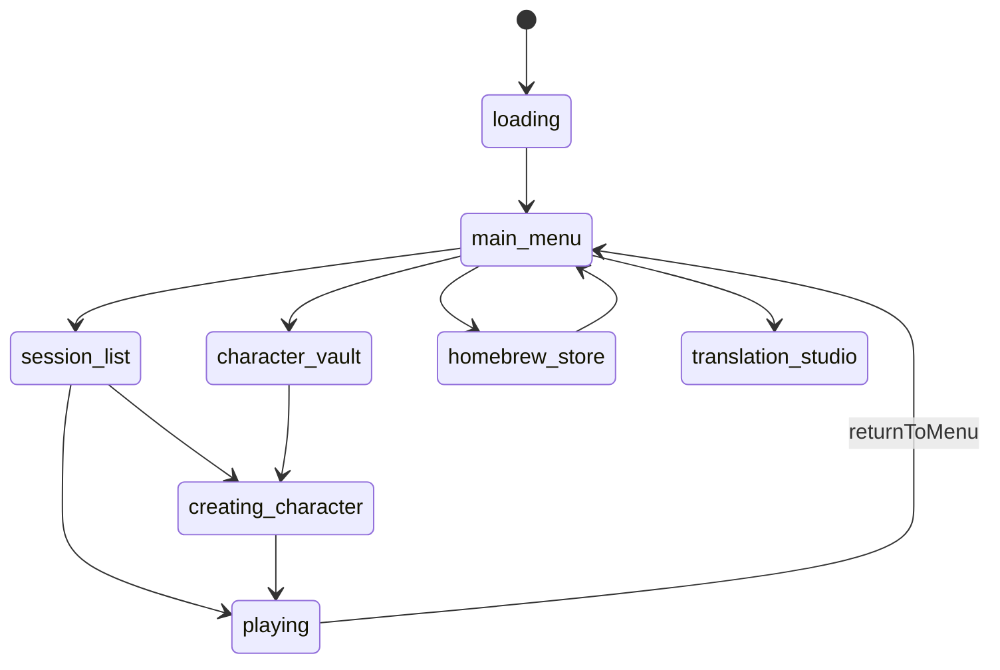
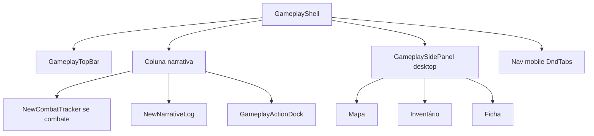
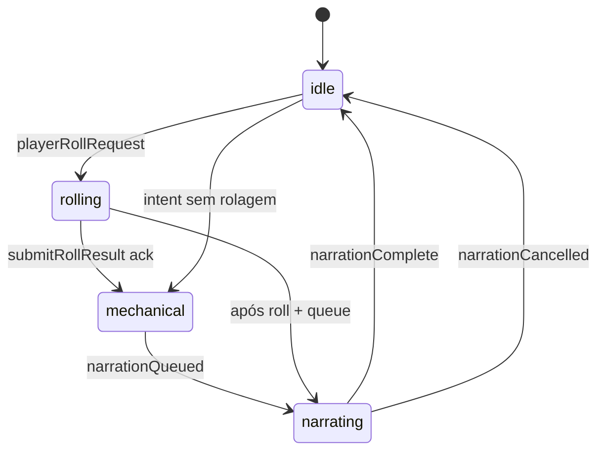
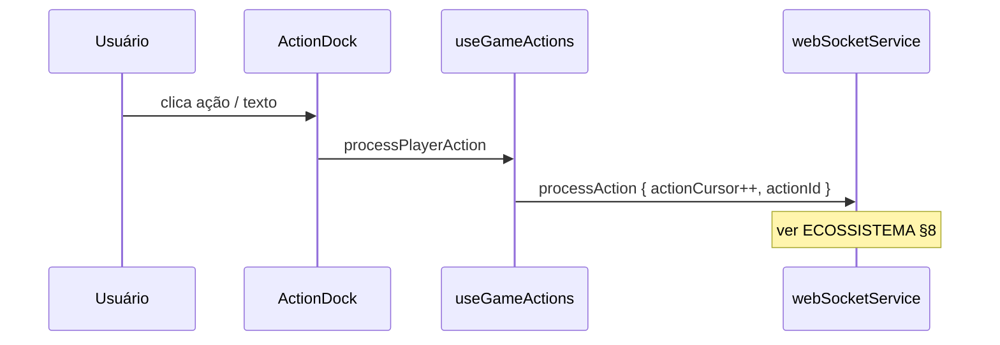
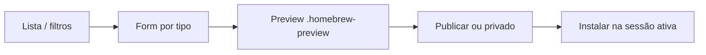

# Crônicas de Aventuras — Design e frontend

> **Documento canônico** da camada de apresentação para revisão sênior de UX/UI. Complementa **ECOSSISTEMA.md** (backend, IA, dados). Índice: **VALIDACAO_SENIOR.md**.
>
> **Referência de atmosfera (não copiar assets):** [Dungeons & Dragons — site oficial](https://www.dungeonsanddragons.com/)
>
> **Última revisão:** maio de 2026 (cinematográfico/BG3-like + InputGate)

---

## Sumário

1. [Princípios de design](#1-princípios-de-design)
2. [Identidade visual vs site WotC](#2-identidade-visual-vs-site-wotc)
3. [Tokens — referência completa](#3-tokens--referência-completa)
4. [UI v2 vs legado](#4-ui-v2-vs-legado)
5. [Arquitetura de navegação (GameStage)](#5-arquitetura-de-navegação-gamestage)
6. [GameplayShell — layout](#6-gameplayshell--layout)
7. [Pipeline visual do turno](#7-pipeline-visual-do-turno)
8. [Estado React e WebSocket](#8-estado-react-e-websocket)
9. [Componentes da mesa](#9-componentes-da-mesa)
10. [Homebrew e tradução (UI)](#10-homebrew-e-tradução-ui)
11. [Áudio, TTS e imersão](#11-áudio-tts-e-imersão)
12. [Responsivo e acessibilidade](#12-responsivo-e-acessibilidade)
13. [Checklist PR e manutenção](#13-checklist-pr-e-manutenção)

---

## 1. Princípios de design

| Princípio | Implementação |
|-----------|----------------|
| **Mesa primeiro** | Log narrativo é o centro visual; mecânica em painéis laterais |
| **Fantasia premium** | Escuro cinematográfico + ouro + vermelho ember — não SaaS cinza |
| **Feedback honesto** | Números do motor antes do parágrafo IA |
| **InputGate absoluto (BG3-like)** | Ações state-changing só liberam após `narrationComplete` (ou falha final) |
| **Legibilidade** | Pergaminho/claro sobre fundo escuro para texto longo |
| **Toque moderno** | `100dvh`, safe areas, dock flutuante no mobile |
| **Marca respeitosa** | Inspirar WotC; não usar IP protegida |

**Skill operacional (PRs frontend):** `dndai-frontend-cinematic-design` (usa checklist e invariantes; evita regressão de “cinematográfico/BG3-like”).

---

## 2. Identidade visual vs site WotC

O [site D&D](https://www.dungeonsanddragons.com/) (2026) usa:

- Hero **fullscreen** escuro com acento vermelho
- Tipografia **serifada display** em manchetes
- Seções editoriais “Discover / Play your way / Community”
- CTAs de alto contraste
- Sensação **cinematográfica**, não tabela administrativa

### 2.1 Tradução para Crônicas

| Site WotC | Nosso produto |
|-----------|---------------|
| Hero vídeo + vermelho | `--dnd-bg-cinematic` + CTAs `dnd-ember` |
| “Continue your journey” | Hub → retomar sessão / cofre |
| Actual play / comunidade | Log + `StoryHighlightsCard` |
| D&D Beyond (ecossistema) | Integração SRD + homebrew próprio |
| Multiverso (games, streaming) | **Fora de escopo** — foco mesa IA |

### 2.2 O que não copiar

- Logo ampersand WotC, personagens licenciados, key art oficial
- Footer legal WotC
- Carrosséis de produtos terceiros

---

## 3. Tokens — referência completa

Fonte: `src/design-system/tokens.css` → Tailwind `dnd.*`.

### 3.1 Cores (hex)

| Token CSS | Hex | Tailwind | Uso |
|-----------|-----|----------|-----|
| `--dnd-ember` | `#e40712` | `dnd-ember` | CTA, perigo, combate |
| `--dnd-ember-hover` | `#ff2430` | `dnd-ember-hover` | Hover CTA |
| `--dnd-ember-deep` | `#9b0610` | `dnd-ember-deep` | Pressed |
| `--dnd-gold` | `#d4af37` | `dnd-gold` | Bordas, títulos |
| `--dnd-gold-bright` | `#f0d878` | `dnd-gold-bright` | Hover ouro |
| `--dnd-obsidian` | `#050506` | `dnd-obsidian` | Fundo base |
| `--dnd-obsidian-raised` | `#121216` | `dnd-obsidian-raised` | Cards |
| `--dnd-parchment` | `#f7f0e3` | `dnd-parchment` | Texto narrativo |
| `--dnd-parchment-muted` | `#b8a88c` | `dnd-parchment-muted` | Meta |
| `--dnd-success` | `#2d8a4e` | `dnd-success` | Cura / sucesso |
| `--dnd-danger` | `#e40712` | `dnd-danger` | Dano |

### 3.2 Tipografia

| Token | Família | Uso |
|-------|---------|-----|
| `--font-display` | Cinzel Decorative | Títulos, hub |
| `--font-narrative` | IM Fell English | Log, citações |
| `--font-ui` | Inter | Forms, labels densos |

### 3.3 Motion

| Token | Valor | Uso |
|-------|-------|-----|
| `--dnd-duration-ui` | 200ms | Hover, tabs |
| `--dnd-duration-scene` | 700ms | Transições de estágio |
| `--dnd-ease-out-expo` | cubic-bezier | Entrada hero |

### 3.4 Sombras

- `shadow-card` — painéis mesa
- `shadow-elevated` — modais
- `shadow-hero` — hub landing

### 3.5 Regra de migração

**Novas telas:** só `dnd-*`. **Legado:** `stone-*` / `amber-*` — refatorar ao tocar.

---

## 4. UI v2 vs legado

| Área | v2 (padrão) | Legado (`NEXT_PUBLIC_UI_V2=false`) |
|------|-------------|-------------------------------------|
| Entrada | `AuthGateV2` | `AuthGate` |
| Hub | `features/hub/HubShell` | `GameMenuContentLegacy` |
| Mesa | `GameplayScreen` + `GameplayShell` | `GameScreenLegacy` |
| Combate | `GameplayCombatTracker` | `NewCombatTracker` (branch) |
| Personagem | `CharacterCreationWizard` | `NewCreationCharacter` steps |
| Homebrew | `HomebrewStorePage` | `HomebrewStore` monólito |

**Política (realista, alinhada ao código atual):**

- O legado **ainda existe** e está atrás de `NEXT_PUBLIC_UI_V2=false` por compatibilidade.
- **Não adicionar features** nem melhorias no legado. Qualquer mudança deve ir para v2.
- Objetivo: **remover a necessidade da flag** e deletar caminhos `*Legacy` quando a v2 estiver estável o suficiente para produção (sem “limbo” de turno, sem regressões de gameplay).

---

## 5. Arquitetura de navegação (GameStage)



### 5.1 Responsabilidades por estágio

| Estágio | UX |
|---------|-----|
| `loading` | Traduções (se flag), sessões, personagens |
| `main_menu` / hub | Hero, música ambiente, CTAs |
| `session_list` | Cards de aventura |
| `character_vault` | Cofre reutilizável |
| `creating_character` | Wizard multi-step |
| `homebrew_store` | CRUD + instalar na sessão |
| `translation_studio` | Overlay SRD |
| `playing` | **GameplayShell** |

Orquestrador: `GameContainer` + `GameStateProvider`.

---

## 6. GameplayShell — layout

### 6.1 Árvore de composição



### 6.2 Desktop (lg+)

```
┌────────────────────────────────────────────────────────────┐
│ GameplayTopBar — região, hora, TTS, settings, menu         │
├──────────────────────────────┬─────────────────────────────┤
│ [Combate tracker se ativo]   │  Side panel (tabs)          │
│                              │  Mapa | Inv | Ficha         │
│  NewNarrativeLog (scroll)    │                             │
│                              │                             │
│  GameplayActionDock          │                             │
└──────────────────────────────┴─────────────────────────────┘
```

### 6.3 Mobile (< lg)

- Abas inferiores: **Narrativa | Mapa | Inventário | Ficha | Menu**
- Dock de ações **sobreposto** na coluna narrativa (`pointer-events` + safe bottom)
- Teclado virtual: `useKeyboardViewportInset` ajusta padding do dock

### 6.4 Primitivos visuais

- `AmbientBackground` — gradiente vivo
- `Vignette` — bordas escurecidas
- `DndTabs`, `DndButton` — família UI v2

---

## 7. Pipeline visual do turno (BG3-like)

> **Mesa PENAI** (`NEXT_PUBLIC_PENAI_WS=true`): mesmo pipeline via `usePenaiTurnPipeline` + WS v2 — ver [`PENAI.md`](./PENAI.md) §12. **Lobby:** nova aventura/continuar usa `POST/GET /api/v2/sessions` + `/mechanical` (`usePenaiGameSession`, `penaiCharacterAdapter`) — sem fetch MySQL de ficha no load.

Espelha o backend (ECOSSISTEMA §5).



| Fase UI | Comportamento |
|---------|---------------|
| `idle` | Dock ativo; usuário pode agir |
| `rolling` | Modal `DiceRollModal` + dice-box 3D |
| `mechanical` | Toast / patch ficha visível |
| `narrating` | “Motor validou” + DM narrando; dock e ações state-changing bloqueadas |

### 7.1 InputGate (hard-lock até `narrationComplete`)

Inspirado no ritmo de combate de jogos como **Baldur’s Gate 3**: após uma ação ser aceita, a UI **não** deve permitir empilhar novas intenções mecânicas enquanto o turno está “fechando” (hot path mecânico + worker narrativo).

Estado `InputGate` (derivado do pipeline + sinais WS):

| Gate | Quando | Efeito |
|------|--------|--------|
| `OPEN` | `idle` e sem pendências | permite intents (dock/free action) |
| `LOCKED_MECHANICAL` | ação aceita / loading / `mechanical` | bloqueia ações state-changing |
| `LOCKED_ROLLING` | `playerRollRequest` pendente | só o modal de dados pode enviar roll |
| `LOCKED_NARRATING` | `narrating` | bloqueia até `narrationComplete` |

**Regra de ouro:** liberar input state-changing **apenas** em `narrationComplete` (ou falha final + `stopLoading`).

**Regra:** nunca commitar `gameStateUpdate` com `actionSequence` menor que `latestActionSequenceRef`.

---

## 8. Estado React e WebSocket

### 8.1 Camadas de estado

| Camada | Responsabilidade |
|--------|------------------|
| `GameStateProvider` | Sessão ativa, personagem, log, combate |
| `useNewGameState` | Agregador gameplay |
| `useGameActions` | `processPlayerAction`, intents |
| `useGameWebSocket` | Listeners WS |
| `turnPipelineStore` | Fase UI do turno |
| `InputGate` | “Hard-lock” do input state-changing |
| `SettingsContext` | API key, TTS, modelo |

### 8.2 Eventos WS ouvidos (mesa)

| Evento | Efeito UI |
|--------|-----------|
| `mechanicalStateUpdate` | Patch HP/inventário/combate; fase `mechanical` |
| `narrationQueued` | Fase `narrating` |
| `narrationCancelled` | Libera loading ação antiga |
| `gameStateUpdate` | Merge log + opções (com filtro sequence) |
| `narrationComplete` | Volta `idle` |
| `narrationStream` | Preview opcional — **não canônico** |
| `startLoading` / `stopLoading` | Spinner global |
| `actionResolution` | Caminhos híbridos legados |
| `pendingRollState` | Heal: reabre rolagem pendente após reconnect |

### 8.3 Fluxo envio de ação



---

## 9. Componentes da mesa

| Componente | Função |
|------------|--------|
| `NewNarrativeLog` | Scroll log; destaques; TTS por entrada |
| `GameplayActionDock` | Botões contextuais (exploração, social, combate) |
| `GameplayTopBar` | Região, relógio, toggle narração/TTS |
| `GameplaySidePanel` | Tabs desktop |
| `DiceRollModal` | Integração dice-box |
| `ShopModal` / level-up modais | Motor disparou estado |
| `StoryHighlightsCard` | Resumo momentos (hub/log) |
| `SettingsModal` | Modelo, voz, velocidade |

### 9.1 Dock contextual

Ações derivadas de `contextualDockActions` — mudam com região, combate, fase pipeline.

### 9.2 Combate na mesa

`showCombat` no shell → faixa `NewCombatTracker` acima do log — iniciativa e HP visíveis sem cobrir narrativa.

---

## 10. Homebrew e tradução (UI)

### 10.1 Oficina (`homebrew_store`)



| Tipo form | Campos guiados |
|-----------|----------------|
| race, class, spell, … | Wizard por tipo 5e API |
| translation | `sourceIndex` + overlay PT |
| AI creator | Gera JSON validado |

Badges `sourceKind`: original | translation | fork.

### 10.2 Estúdio de tradução

- Lista recursos SRD
- Editor overlay campos traduzíveis
- Preview lado a lado (EN vs PT)

### 10.3 Tradução global UI

- `loadTranslations()` no boot se `NEXT_PUBLIC_ENABLE_TRANSLATIONS=true`
- `translateRace`, `translateClass`, etc. em `translator.ts`
- Sem flag → termos EN do SRD nas listas

**Gap de produto:** PT completo exige flag + banco populado + homebrew translation nas sessões.

---

## 11. Áudio, TTS e imersão

| Recurso | Quando |
|---------|--------|
| `useStageAmbientSound` | Hub vs `playing` |
| `useMenuMusicCrossfade` | Menu principal |
| Narração TTS | Piper via backend após `gameStateUpdate` |
| Vinheta dados | CSS flash em `globals.css` |

Config: `narrationVoice` (faber, razo, miro, dii), `narrationSpeed` no WS.

---

## 12. Responsivo e acessibilidade

| Requisito | Status |
|-----------|--------|
| `100dvh` + safe areas | Implementado |
| Dock acessível com teclado aberto | `keyboardViewportInset` |
| Contraste pergaminho/obsidian | OK narrativa |
| Ember não único indicador de erro | Ícone + texto |
| `prefers-reduced-motion` | Parcial — aplicar em heroes |
| Touch ≥ 44px dock | Meta |

---

## 13. Checklist PR e manutenção

### PR frontend

- [ ] Tokens `dnd.*` (sem stone/amber novo)
- [ ] `playing` + hub testados
- [ ] `turnPipeline` respeitado
- [ ] `actionSequence` / loading
- [ ] Sem assets WotC
- [ ] Atualizar este doc se novo estágio ou shell

### Onde documentar mudanças

| Mudança | Doc |
|---------|-----|
| Cor, layout, estágio | **DESIGN_FRONTEND.md** (aqui) |
| WS, fila, IA | **ECOSSISTEMA.md** |
| Decisão dev longa | **MOM** + doc |

Screenshots: `docs/ui-screenshots/` (referência PR, não spec).

---

*Fim do design frontend.*
