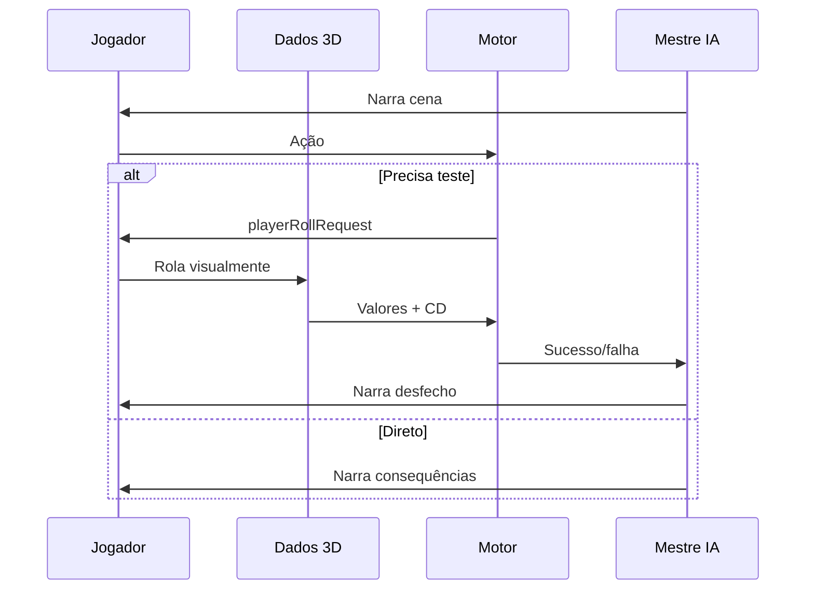

# Fluxo do Mestre (DM Turn Pipeline)

## Ciclo de jogo (padrão: dados 3D)

## Variáveis

| Variável | Padrão | Descrição |
|----------|--------|-----------|
| `DM_AUTO_ROLL` | **`false`** | Se `true`, servidor rola sozinho (sem 3D) |
| `DM_CLASSIFY_FREE_ACTION` | `true` | Heurística PT + **intenção D&D 5e** (`skillActionSemantics`) |
| `DM_LLM_CLASSIFY` | `true` | LLM classifica se heurística falhar (também passa pelo reconciliador) |
| `DM_CLASSIFY_MODEL` | (opcional) | Modelo só para classificar |

## Elenco e mundo

- API `/api/sessoes/:id/cast` — NPC, aliado, inimigo, import do cofre
- **Presença cross-user**: outros jogadores na mesma região aparecem como ecos no prompt

## Componentes

- Cliente: `DiceRollModal` + `@3d-dice/dice-box`
- Backend: `dmTurnOrchestrator.ts`, `issuePendingRollToPlayer`, `narrateAfterPlayerRoll`
