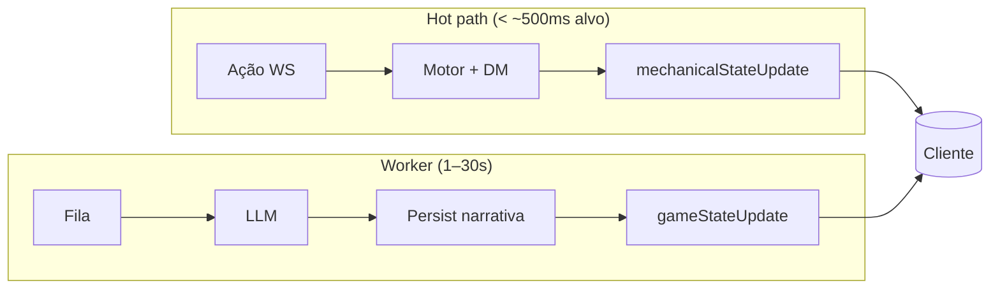
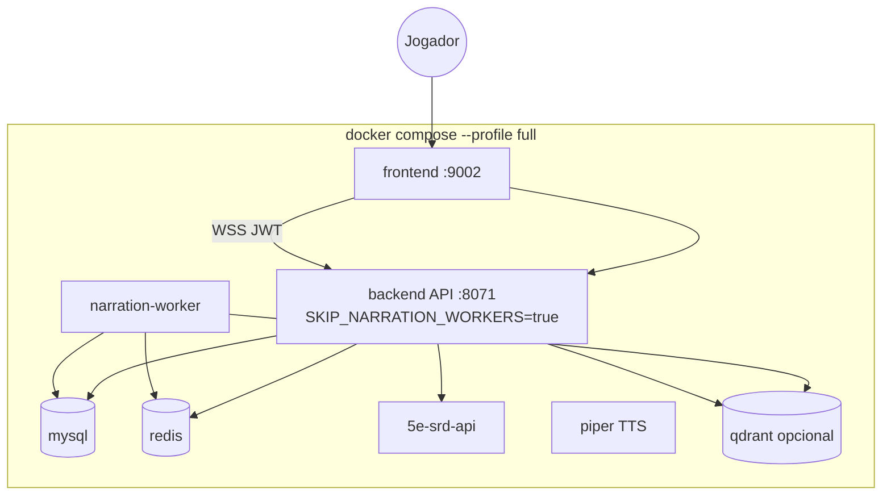
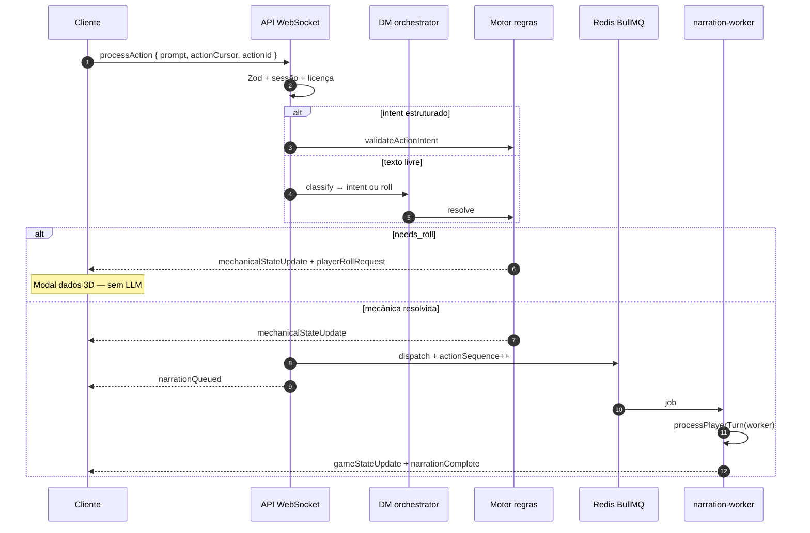
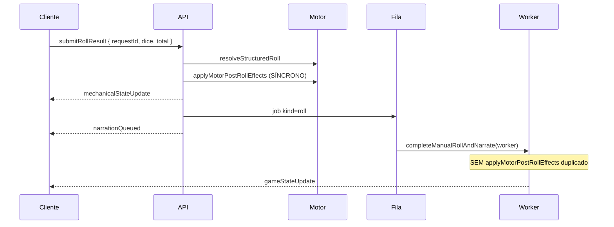
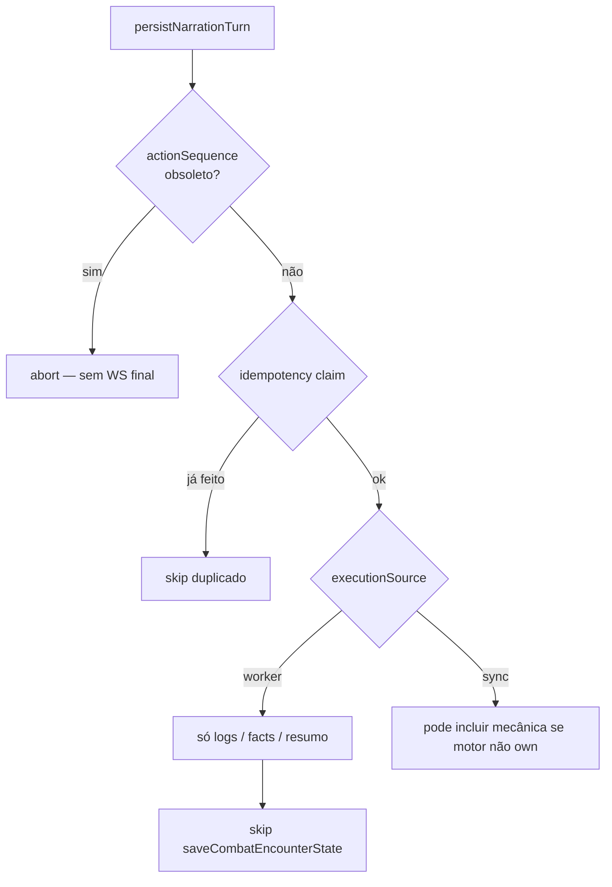
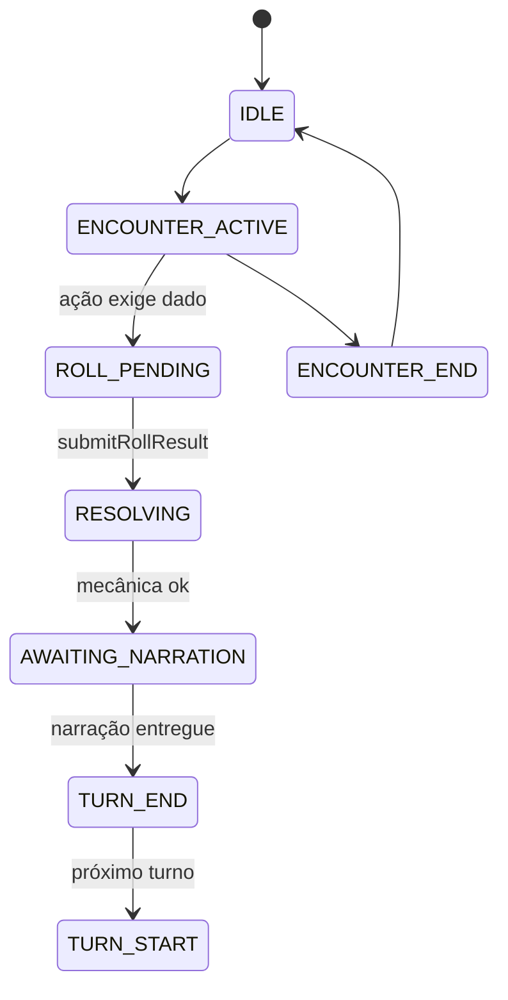
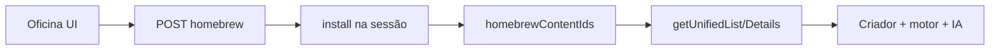
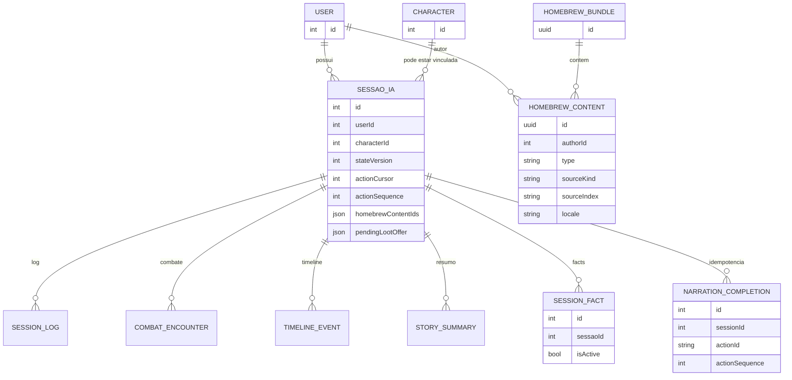

# Crônicas de Aventuras — Ecossistema técnico completo

> **Documento canônico** para revisão sênior, onboarding e agentes de IA. Descreve o sistema **como está implementado** (maio/2026). Complemento visual: **DESIGN_FRONTEND.md**. Índice de revisão: **VALIDACAO_SENIOR.md**.
>
> **Última revisão:** maio de 2026 (pós‑P5: retry crítico BullMQ + heal roll reconnect + remediação determinística)

---

## Sumário

1. [Visão e contexto](#1-visão-e-contexto)
2. [Histórico arquitetural P0–P5](#2-histórico-arquitetural-p0p5)
3. [Invariantes e anti-padrões removidos](#3-invariantes-e-anti-padrões-removidos)
4. [Topologia de deploy](#4-topologia-de-deploy)
5. [Fluxo ponta a ponta — diagramas](#5-fluxo-ponta-a-ponta--diagramas)
6. [Motor de regras D&D 5e](#6-motor-de-regras-dd-5e)
7. [Camada DM (orquestrador pré-LLM)](#7-camada-dm-orquestrador-pré-llm)
8. [WebSocket — protocolo atual](#8-websocket--protocolo-atual)
9. [Fila BullMQ e P4/P5](#9-fila-bullmq-e-p4p5)
10. [Inteligência artificial e OSS](#10-inteligência-artificial-e-oss)
11. [Schemas e contratos de dados](#11-schemas-e-contratos-de-dados)
12. [Persistência MySQL](#12-persistência-mysql)
13. [Redis — fila e snapshot narrativo](#13-redis--fila-e-snapshot-narrativo)
14. [Qdrant, embeddings e RAG](#14-qdrant-embeddings-e-rag)
15. [Homebrew e traduções](#15-homebrew-e-traduções)
16. [Observabilidade e operação](#16-observabilidade-e-operação)
17. [Roadmap e limitações honestas](#17-roadmap-e-limitações-honestas)
18. [Glossário](#18-glossário)

---

## 1. Visão e contexto

### 1.1 O produto

RPG de mesa digital **D&D 5ª edição** com três pilares acoplados:

| Pilar | Responsável | Exemplos |
|-------|-------------|----------|
| **Mecânica** | Motor Node determinístico | HP, CA, combate, inventário, rolagens, XP, viagem, loja |
| **Narrativa** | LLM (fila assíncrona) | Log, tom, diálogos, opções sugeridas |
| **Apresentação** | Next.js | Hub, mesa, dados 3D, mapa, homebrew |

### 1.2 Separação fundamental



O jogador **vê números e estado** antes do parágrafo longo. A IA **não** é fonte de verdade para HP, inventário ou combate (`narration_only`).

### 1.3 Stack

| Camada | Tecnologia |
|--------|------------|
| Frontend | Next.js 15, React 18, Tailwind, Framer Motion, Radix, `@3d-dice/dice-box` |
| API | Express + `ws`, TypeORM |
| MySQL | Sessões, personagens, combate, homebrew, facts, backlog vetorial |
| Redis | BullMQ, cache, snapshot narrativo gzip |
| Qdrant | Coleção `session_memories` (opcional) |
| SRD | Fork 5e API + MongoDB |
| LLM | OpenRouter (OSS); legado Gemini/OpenRouter |
| Embed | OpenRouter Nemotron ~2048d |
| TTS | Piper HTTP |
| Auth | JWT |

---

## 1.4 Como ler este documento (mapa rápido)

Se você quer “achar o detalhe técnico” rápido:

- **Protocolo WS (mensagens + payloads JSON)**: §8 + Apêndice A
- **Schemas (ProcessAction, GameMasterResponse, minimal OSS JSON)**: §11 + Apêndice B
- **Prompts / OSS e contrato do LLM**: §10 + Apêndice B
- **Fila + P4/P5 (order, idempotência, cancel, split worker)**: §9 + Apêndice C
- **RAG / embeddings / Qdrant (store/recall + fallback)**: §14 + Apêndice D
- **Redis snapshot (`gz1:`)**: §13 + Apêndice E
- **Homebrew / tradução (merge e limites)**: §15 + Apêndice F

Este texto descreve o **shape e o comportamento**. Quando algo é “conceitual”, vem marcado como tal.

---

## 2. Histórico arquitetural P0–P5

Evolução **sem feature flags** de arquitetura no `.env` — comportamento único em produção.

| Fase | Problema que atacava | Entrega |
|------|----------------------|---------|
| **P0.1** | Sem trilha de auditoria | Event log append-only |
| **P0.2** | IA no caminho crítico de latência | `mechanicalStateUpdate` antes da narração |
| **P0.3** | JSON LLM enorme e frágil | Schema OSS minimalista + registry de ações |
| **P0.4** | Combate implícito na IA | FSM `combatPhase` no motor |
| **P0.5** | `webSocketServer` monolítico | `action-pipeline/` handlers |
| **P1** | Cegueira operacional | Latências em `/api/admin/ai-metrics` |
| **P2** | Narração bloqueando API | BullMQ + worker |
| **P4.1** | Narração fora de ordem | `actionSequence` por sessão |
| **P4.2** | Retry duplicando log | `narration_completions` + claim |
| **P4.3** | Jobs fantasma na fila | Cancel + `narrationCancelled` |
| **P4.4** | Debug E2E difícil | `pipelineTrace` |
| **P4.5** | Contexto IA caro | Snapshot Redis |
| **P4.6** | Stream confundindo cliente | Stream não canônico |
| **P4.8** | REST divergente do WS | `restNarrationEnqueue` |
| **P5.1** | API + worker mesmo processo | `SKIP_NARRATION_WORKERS` + container worker |
| **P5.2** | Worker regravando combate | `executionSource` + append-only |
| **P5.3** | JSON quebrado silencioso | `json_repair_alert` |
| **P5.4** | Prosa vs motor | `narrativeConsistencyValidator` |
| **P5.5** | Redis I/O pesado | Snapshot `gz1:` + cache `region_graph` |

**Adiado:** P5.6 lock Redis; P5.4.3 retry LLM automático; Session Actor / Kafka / MMO.

---

## 3. Invariantes e anti-padrões removidos

### 3.1 Invariantes (não quebrar)

1. Motor persiste mecânica no hot path (`executionSource: sync`).
2. Worker persiste **só** narrativa (logs, facts, resumos) quando `motorOwnsState`.
3. `actionSequence` monotônico por sessão; cliente descarta WS com sequence menor.
4. `actionCursor` monotônico no cliente (anti-replay de submit).
5. `contractVersion: 1` — rejeitar versões desconhecidas.
6. Modo único `AI_PIPELINE_MODE=narration_only`.

### 3.2 Removido (não reintroduzir)

| Anti-padrão | Motivo |
|-------------|--------|
| `MECHANICAL_NARRATIVE_SPLIT` flag | Sempre ligado |
| Fila `redis-list` legada | BullMQ único |
| `NARRATION_WORKER_INLINE` flag | `SKIP_NARRATION_WORKERS` explícito |
| IA fase “state” separada | `statePhase: null` |
| Worker `saveCombatEncounterState` | P5.2 race |

---

## 4. Topologia de deploy



**Dev local — um processo:** API chama `startNarrationWorkers()` no mesmo Node.

**Dev local — P5 fiel:** `SKIP_NARRATION_WORKERS=true` na API + `npm run worker:narration`.

---

## 5. Fluxo ponta a ponta — diagramas

### 5.1 `processAction` — texto livre ou intent



### 5.2 `submitRollResult` — dados 3D



### 5.3 Política P5.2 no worker



---

## 6. Motor de regras D&D 5e

### 6.1 Intents suportados (lista fechada)

| Intent | Função |
|--------|--------|
| `weapon-attack` | Ataque com arma; pode exigir rolagem |
| `spell-attack` | Ataque mágico; slots |
| `skill-check` | Perícia + CD ou dificuldade |
| `rest` | Descanso curto/longo |
| `damage` / `healing` | Delta direto |
| `consume-item` | Consumir recurso |
| `travel` | Viagem entre regiões |
| `equip-item` / `drop-item` | Inventário |
| `claim-loot` | Loot pendente |
| `open-shop` / `buy-item` / `sell-item` / `close-shop` | Economia |
| `quest-complete` | Marco de quest |
| `start-encounter` | Iniciar combate |

Sem `intent`, o fluxo passa pelo **DM** (classificação). Com `intent`, validação SRD + snapshot de personagem.

### 6.2 Resultado do motor (`RuleCheckResult`)

Status típicos:

| Status | Significado | Próximo passo |
|--------|-------------|---------------|
| `needs_roll` | `playerRollRequest` emitido | `submitRollResult` |
| `accepted` | Delta aplicável | Enfileirar narração |
| `rejected` | Regra inválida | `systemLog` ao cliente |

### 6.3 FSM de combate

Fases: `IDLE` → `ENCOUNTER_ACTIVE` → `ROUND_START` → `TURN_START` → `ACTION_DECLARED` → `ROLL_PENDING` → `RESOLVING` → `AWAITING_NARRATION` → `TURN_END` → … → `ENCOUNTER_END` → `IDLE`.



A IA **não** transiciona fases — só o motor.

### 6.4 Mundo e regiões

- Grafo de regiões com POIs, rotas descobertas, viagem validada.
- **Elenco (cast):** NPCs/aliados/inimigos registrados na sessão; presença de outros usuários na mesma região pode entrar no prompt como eco.

---

## 7. Camada DM (orquestrador pré-LLM)

**Não** escreve o parágrafo final da aventura. Responsabilidades:

| Etapa | Descrição |
|-------|-----------|
| Classificação | Heurística PT + opcional LLM pequeno (`DM_LLM_CLASSIFY`) |
| Perícias | `skillActionSemantics` corrige skill/ability incoerentes |
| Rolagem | `issuePendingRollToPlayer` — estrutura dados, mod, CD, motivo |
| Auto-roll | `DM_AUTO_ROLL=true` pula 3D (servidor rola) |

Variáveis:

| Variável | Padrão típico | Efeito |
|----------|---------------|--------|
| `DM_AUTO_ROLL` | `false` | Dados 3D no cliente |
| `DM_CLASSIFY_FREE_ACTION` | `true` | Heurística |
| `DM_LLM_CLASSIFY` | `true` | Fallback LLM |

Após o motor resolver, o **prompt DM** alimenta o job na fila (contexto mecânico já fixo).

---

## 8. WebSocket — protocolo atual

### 8.1 Conexão

- URL com **JWT** (query ou protocolo acordado com o cliente).
- Reconexão com backoff no frontend.

### 8.2 Cliente → servidor

#### `processAction`

| Campo | Tipo | Obrigatório | Notas |
|-------|------|-------------|-------|
| `contractVersion` | number | recomendado | Deve ser `1` |
| `sessionId` | number | sim | |
| `prompt` | string | se sem intent | Texto livre |
| `intent` | `{ type, payload }` | opcional | Ver §6.1 |
| `combatState` | object | opcional | Espelho cliente |
| `actionId` | string UUID | recomendado | Correlação |
| `actionCursor` | number | recomendado | Monotônico |
| `clientStateVersion` | number | opcional | |
| `clientInstanceId` | string | opcional | Lease de aba |
| `apiKey` / `model` | string | opcional | Se não server keys |
| `useAiHomebrew` | boolean | opcional | |
| `narrationVoice` / `narrationSpeed` | enum | opcional | TTS |

#### `submitRollResult`

| Campo | Notas |
|-------|-------|
| `sessionId`, `requestId` | Liga ao `playerRollRequest` |
| `result.dice`, `modifier`, `total` | Do modal 3D |
| `clientStateVersion` | |

#### `syncPendingRoll` (heal de rolagem pendente)

Uso: após reconectar, o cliente pede ao servidor o `playerRollRequest` que ainda estiver pendente (ex.: Redis) para reabrir o modal 3D e evitar “limbo 409”.

| Campo | Notas |
|-------|-------|
| `sessionId` | Sessão alvo |

### 8.3 Servidor → cliente (ordem típica)

| Tipo | Quando | Canônico? |
|------|--------|-----------|
| `actionAck` | Aceitou ação | sim |
| `startLoading` | Processando | sim |
| `mechanicalStateUpdate` | Delta mecânico pronto | **sim — fonte mecânica** |
| `narrationQueued` | Job na fila | sim |
| `narrationCancelled` | Ação superseded | sim |
| `narrationStream` | Chunk preview | **não** — UI não deve commitar |
| `gameStateUpdate` | Pacote completo pós-narração | **sim — log narrativo** |
| `narrationComplete` | Fim ciclo narrativo | sim |
| `stopLoading` | Libera spinner | sim |
| `actionResolution` | Caminhos legados / híbridos | parcial — ainda ouvido no cliente |
| `pendingRollState` | Resposta do `syncPendingRoll` | sim — heal UX |
| `error` / `timeout` | Falha | sim |

### 8.4 Cliente — descarte por `actionSequence`

O hook de WS mantém `latestActionSequenceRef`. Mensagens `gameStateUpdate` / `narrationComplete` com sequence **menor** que a referência são ignoradas (P4.1).

---

## Apêndice A — Especificação do protocolo WebSocket (contrato prático)

> Objetivo: permitir que alguém implemente um cliente mínimo ou revise compatibilidade sem “adivinhar” campos.
>
> Nota: alguns campos são opcionais por legado; o contrato recomendado é enviar o máximo para observabilidade (`actionId`, `actionCursor`, `contractVersion`).

### A.1 Envelope

Todas as mensagens têm:

```json
{
  "type": "string",
  "payload": {}
}
```

### A.2 Cliente → Servidor: `processAction`

Payload recomendado (contrato atual `contractVersion: 1`):

```json
{
  "contractVersion": 1,
  "sessionId": 123,
  "prompt": "Eu ataco o goblin.",
  "intent": {
    "type": "weapon-attack",
    "payload": {
      "weaponIndex": "longsword",
      "targetArmorClass": 13
    }
  },
  "combatState": null,
  "useAiHomebrew": true,
  "model": "openai/gpt-oss-120b:free",
  "apiKey": "opcional (se não server keys)",
  "clientStateVersion": 7,
  "actionId": "uuid-v4",
  "clientInstanceId": "frontend-tab-XYZ",
  "actionCursor": 42,
  "narrationVoice": "faber",
  "narrationSpeed": "normal"
}
```

Campos críticos:

| Campo | Por quê |
|------|---------|
| `actionCursor` | anti-replay (ordem do cliente) |
| `actionId` | idempotência/observabilidade do ciclo |
| `contractVersion` | evoluir sem quebrar clientes antigos |

### A.3 Cliente → Servidor: `submitRollResult`

```json
{
  "sessionId": 123,
  "requestId": "roll-789",
  "clientStateVersion": 7,
  "result": {
    "dice": [15],
    "modifier": 5,
    "total": 20
  }
}
```

Regra P5: o pós-roll mecânico acontece **no síncrono**; o job do worker é apenas narrativo.

### A.4 Servidor → Cliente: eventos principais

| Evento | Intenção | Canônico |
|--------|----------|----------|
| `actionAck` | confirmação rápida | sim |
| `startLoading` / `stopLoading` | spinner/timeout | sim |
| `mechanicalStateUpdate` | delta mecânico (motor) | **sim (mecânica)** |
| `narrationQueued` | job aceito na fila | sim |
| `narrationCancelled` | job obsoleto; liberar loading | sim |
| `narrationStream` | preview | **não** |
| `gameStateUpdate` | pacote final do ciclo | **sim (log/prosa)** |
| `narrationComplete` | fim do ciclo narrativo | sim |
| `actionResolution` | legado/híbrido | parcial |
| `error` / `timeout` | falhas | sim |

### A.5 Regra de ordering (P4)

`gameStateUpdate` e `narrationComplete` carregam `actionSequence`. O cliente mantém o maior sequence visto; qualquer mensagem com sequence menor é descartada.

---

## Apêndice A.6 — Payloads reais (campo → tipo → obrigatório → origem)

> **Sem inventar:** as tabelas abaixo refletem os types/handlers atuais no backend e o consumo no hook do frontend.
>
> **Origem**:
> - **Motor (sync)**: calculado e persistido no hot path
> - **Worker (async)**: produzido no consumer BullMQ (narrativo + enrich)
> - **Cliente**: enviado pelo browser
> - **LLM**: texto/JSON da IA (sempre sanitizado em `narration_only`)
> - **DB/Cache**: lido de MySQL/Redis/Qdrant

### A.6.1 `mechanicalStateUpdate` (Servidor → Cliente)

**Envelope:**

```json
{ "type": "mechanicalStateUpdate", "payload": { "...": "..." } }
```

**Payload (`MechanicalStatePayload`):**

| Campo | Tipo | Obrigatório | Origem | Notas |
|------|------|-------------|--------|------|
| `stateVersion` | number | sim | Motor (sync) | Versão do estado após aplicar regras |
| `actionSequence` | number | não | Motor (sync) | Só aparece quando a ação já foi enfileirada (dispatch) |
| `actionId` | string | não | Cliente → Motor | Correlação do ciclo |
| `updatedCharacter` | object | não | Motor (sync) | Subset de `GameMasterResponse.updatedCharacter` |
| `updatedEntities` | array | não | Motor (sync) | Array com entidade(s) afetada(s) (ex.: HP inimigo) |
| `combatState` | object|null | não | Motor (sync) | Estado de combate quando relevante |
| `playerRollRequest` | object|null | não | Motor (sync) | Pedido de rolagem (dados 3D) |
| `lootOffer` | object|null | não | Motor (sync) | Oferta de loot (quando aplicável) |
| `attackOutcome` | `{ hit?: boolean }` | não | Motor (sync) | Feedback rápido de acerto/erro |

**Como o frontend aplica:** ele injeta `updatedCharacter/combatState/playerRollRequest/lootOffer/stateVersion` num shape compatível de `GameMasterResponse`, com `logEntries=[]` e `actionOptions=[]`, e muda a fase do turno para `mechanical`.

### A.6.2 `narrationQueued` (Servidor → Cliente)

```json
{
  "type": "narrationQueued",
  "payload": { "actionId": "uuid", "sessionId": 123, "actionSequence": 9 }
}
```

| Campo | Tipo | Obrigatório | Origem | Notas |
|------|------|-------------|--------|------|
| `actionId` | string | sim | Motor (sync) | |
| `sessionId` | number | sim | Motor (sync) | |
| `actionSequence` | number | sim | Motor (sync) | monotônico por sessão |

### A.6.3 `narrationLoading` (Servidor → Cliente)

```json
{ "type": "narrationLoading", "payload": { "actionId": "uuid", "actionSequence": 9 } }
```

| Campo | Tipo | Obrigatório | Origem | Notas |
|------|------|-------------|--------|------|
| `actionId` | string | não | Motor (sync) | No worker split, normalmente existe |
| `actionSequence` | number | não | Motor (sync) | Às vezes ausente em stream legacy |

### A.6.4 `narrationCancelled` (Servidor → Cliente)

```json
{
  "type": "narrationCancelled",
  "payload": { "actionId": "uuid", "actionSequence": 8, "reason": "superseded" }
}
```

| Campo | Tipo | Obrigatório | Origem | Notas |
|------|------|-------------|--------|------|
| `actionId` | string | sim | Motor (sync) | |
| `actionSequence` | number | sim | Motor (sync) | sequence cancelado (< latest) |
| `reason` | string | sim | Motor (sync) | hoje: `superseded` |

Obs.: o backend também emite `stopLoading` com `{ actionId, actionSequence }` para liberar spinner.

### A.6.5 `narrationComplete` (Servidor → Cliente)

No worker:

```json
{ "type": "narrationComplete", "payload": { "actionId": "uuid", "actionSequence": 9 } }
```

No fluxo inline/legacy pode vir só com `actionId`.

| Campo | Tipo | Obrigatório | Origem | Notas |
|------|------|-------------|--------|------|
| `actionId` | string | não | Worker (async) | |
| `actionSequence` | number | não | Worker (async) | No worker vem preenchido via `enrichWsPayload` |

### A.6.6 `gameStateUpdate` (Servidor → Cliente)

**Envelope:**

```json
{ "type": "gameStateUpdate", "payload": { "...": "..." } }
```

Shape é “**`GameMasterResponse` + metadados de pipeline**”, com campos variando por caso. Existem **dois grupos**:

1) **Campos de schema** (o “contrato do jogo”, validado em partes do pipeline)  
2) **Campos de envelope/pipeline** (usados para ordering/UX, não fazem parte do `GameMasterResponseSchema`)

#### A.6.6.1 Campos de schema (`GameMasterResponseSchema`)

| Campo | Tipo | Obrigatório | Origem | Observação em `narration_only` |
|------|------|-------------|--------|-------------------------------|
| `logEntries` | array | sim | LLM→Worker **ou** motor (sync) | Pode ser `[]` em respostas mecânicas/pending roll |
| `actionOptions` | array | sim | Registry/Worker **ou** motor | No OSS minimal, vem do registry por domínio |
| `systemLog` | string\|null | não | Worker/LLM/motor | Pode carregar notas de contrato/validador |
| `memoryContext` | `{ summary?, references? }` | não | Worker/LLM/DB | Em OSS minimal, pode ser omitido |
| `updatedCharacter` | object | não | **Motor (sync)** | **LLM não pode** setar; worker não aceita merge |
| `combatState` | object\|null | não | **Motor/DB** | Worker pode **ler do MySQL** e projetar estado público |
| `playerRollRequest` | object\|null | não | **Motor (sync)** | LLM não pode criar roll; pode ser suprimido por policy |
| `worldState` | object | não | **Motor (sync)** | Campo motor-owned |
| `xpEvents` / `progressionFeed` | array | não | **Motor (sync)** | Motor-owned |
| `newHomebrewContent` | array | não | LLM (fluxo específico) | Em `narration_only`, criação é controlada e validada |
| `levelUpState` / `shopState` / `lootOffer` / `useHitDiceRequest` | object\|null | não | **Motor (sync)** | Motor-owned (modais) |
| `gameClock` | object | não | **Motor (sync)** | Motor-owned |
| `_meta` | object | não | Pipeline | Depuração/recuperação |

#### A.6.6.2 Campos de envelope/pipeline (extensões)

| Campo | Tipo | Obrigatório | Origem | Por quê existe |
|------|------|-------------|--------|----------------|
| `stateVersion` | number | comum | Motor/Worker | Versão do estado do servidor após a ação |
| `actionSequence` | number | comum | Motor/Worker | Ordering P4; worker propaga do job |
| `actionId` | string | às vezes | Cliente → motor/worker | Correlação (nem sempre incluído em todos os caminhos) |
| `updatedEntities` | array | às vezes | Motor/Worker | Conveniência UI (ex.: HP de um alvo) — **não** faz parte do schema |

#### A.6.6.3 Quais campos aparecem em cada caminho (observado no código)

- **Worker / job `kind=action`**:
  - envia `payload = { ...response, actionSequence }`
  - normalmente inclui `logEntries`, `actionOptions`, `systemLog?`, `stateVersion?` (se retornado), e pode incluir campos extras conforme o motor/validator adiciona notas.

- **Worker / job `kind=roll`**:
  - bump de `stateVersion` antes de entregar
  - inclui `actionSequence`
  - injeta `updatedCharacter` e `updatedEntities` a partir de `resolutionResult` (motor)
  - tenta ler combate do MySQL e incluir `combatState` público

- **Síncrono (sem fila / fallback)**:
  - bump de `stateVersion` se a resposta não trouxer
  - pode emitir `gameStateUpdate` imediatamente (com ou sem `playerRollRequest`)
  - pode emitir `narrationComplete` logo após (fluxo inline)

#### A.6.6.4 O que o LLM não consegue “forçar” (garantia)

Em `narration_only`, a resposta do modelo é reduzida e/ou sanitizada:

- `stripMotorOwnedFields` mantém apenas: `logEntries`, `actionOptions`, `systemLog?`, `memoryContext?`
- campos motor-owned (HP/combate/roll/xp/loot/shop/level-up etc.) são ignorados como fonte autoritativa
  - no worker, a persistência mecânica é pulada (P5.2) e combate é lido do DB
  - `newFacts` pode ser validado e persistido; depois é removido do payload antes de retornar ao cliente

Regra: o frontend chama `acceptActionSequence(payload, latestActionSequenceRef)` antes de aplicar.

### A.6.7 `actionResolution` (Servidor → Cliente)

Esse evento existe para compatibilidade/UX (toasts, needs_roll, etc.). Shape observado no handler:

```json
{
  "type": "actionResolution",
  "payload": {
    "actionId": "uuid",
    "stateVersion": 12,
    "status": "accepted|needs_roll|rejected",
    "result": { \"...GameMasterResponse...\" },
    "stateDelta": { \"...\" }
  }
}
```

| Campo | Tipo | Obrigatório | Origem |
|------|------|-------------|--------|
| `actionId` | string | não | Motor (sync) |
| `stateVersion` | number | não | Motor (sync) |
| `status` | string | não | Motor (sync) |
| `result` | object | não | Motor/LLM | No `narration_only`, mecânica vem do motor |
| `stateDelta` | object | não | Motor (sync) |

---

## Apêndice A.7 — `playerRollRequest` (spec completo)

> Este payload é **do motor** e dispara o modal de dados 3D no cliente. O LLM não deve criar pedidos de rolagem.

### A.7.1 JSON exemplo

```json
{
  "reason": "Persuadir o guarda",
  "dice": "1d20",
  "modifier": 5,
  "dc": 15,
  "rollType": "check",
  "advantage": false,
  "disadvantage": false,
  "requestId": "roll-789",
  "metadata": {
    "source": { "kind": "skill", "index": "persuasion", "name": "Persuasão" },
    "targets": [{ "kind": "entity", "id": "guard-1", "name": "Guarda" }],
    "resourceCosts": []
  }
}
```

### A.7.2 Tabela (campo → tipo → obrigatório → origem → notas)

| Campo | Tipo | Obrigatório | Origem | Notas |
|------|------|-------------|--------|------|
| `reason` | string | sim | Motor (sync) | Texto exibido ao jogador |
| `dice` | string | sim | Motor (sync) | Ex.: `1d20`, `2d6` |
| `modifier` | number | sim | Motor (sync) | Mod total calculado |
| `dc` | number | não | Motor (sync) | DC se aplicável |
| `rollType` | enum | sim | Motor (sync) | `check|save|attack|damage|initiative|healing` |
| `advantage` | boolean | não | Motor (sync) | Não pode coexistir com disadvantage |
| `disadvantage` | boolean | não | Motor (sync) | Não pode coexistir com advantage |
| `requestId` | string | não | Motor (sync) | ID correlacionado em `submitRollResult` |
| `metadata` | object | não | Motor (sync) | Contexto rico para UI/telemetria |

**`metadata.source` (quando existir):**

| Campo | Tipo |
|------|------|
| `kind` | `weapon|spell|skill|feature|item` |
| `index` | string? |
| `name` | string? |
| `damageDice` | string? |
| `damageType` | string? |

**`metadata.targets[]` (quando existir):**

| Campo | Tipo |
|------|------|
| `kind` | `character|entity|object` |
| `id` | string? |
| `name` | string? |
| `armorClass` | number? |
| `encounterId` | number? |
| `characterId` | number? |

**`metadata.resourceCosts[]` (quando existir):**

| Campo | Tipo |
|------|------|
| `kind` | `spell-slot|class-resource|item` |
| `level` | number? |
| `resourceKey` | string? |
| `amount` | number? |
| `itemId` | number? |
| `itemIndex` | string? |

### A.7.3 Invariantes

- `advantage` e `disadvantage` não podem ser `true` simultaneamente.
- Em `narration_only`, o worker pode **suprimir** roll requests do modelo (policy `suppressRollRequest`).

---

## Apêndice A.8 — `combatState` (spec do estado público enviado ao cliente)

> O cliente recebe `combatState` para renderizar o tracker. No worker, o combate é **lido do MySQL/Redis cache** e projetado para estado público.

### A.8.1 JSON exemplo (resumo)

```json
{
  "isActive": true,
  "round": 2,
  "turn": 1,
  "initiativeOrder": ["player", "goblin-1"],
  "combatants": [
    {
      "id": "player",
      "name": "Herói",
      "hp": { "current": 18, "max": 24 },
      "ac": 15,
      "initiative": 12,
      "isPlayer": true,
      "attitude": "ally",
      "conditions": [],
      "statusEffects": [],
      "cooldowns": [],
      "distance": 0,
      "zone": "perto",
      "hasMoved": false,
      "hasActed": false,
      "actionPoints": 1,
      "bonusActionPoints": 1,
      "isDead": false,
      "rollHistory": []
    }
  ],
  "log": []
}
```

### A.8.2 Tabela (campo → tipo → obrigatório → origem)

| Campo | Tipo | Obrigatório | Origem |
|------|------|-------------|--------|
| `isActive` | boolean | sim | Motor/DB |
| `round` | number | sim | Motor/DB |
| `turn` | number | sim | Motor/DB (clamp) |
| `combatants` | array | sim | Motor/DB |
| `initiativeOrder` | string[] | não | Motor/DB |
| `log` | array | não | Motor/DB |

### A.8.3 Combatant público (campos principais)

> O estado público é uma projeção do canônico (não inclui tudo). Campos observados na projeção atual:

| Campo | Tipo | Origem |
|------|------|--------|
| `id`, `name` | string | Motor/DB |
| `hp.current`, `hp.max` | number | Motor/DB |
| `ac`, `initiative` | number? | Motor/DB |
| `isPlayer` | boolean? | Motor/DB |
| `attitude` | `hostile|neutral|ally` | Motor/DB |
| `conditions` | string[] | Motor/DB |
| `statusEffects`, `cooldowns` | array | Motor/DB |
| `distance` | number? | Motor/DB |
| `zone` | `perto|medio|longe|coberto`? | Motor/DB |
| `hasMoved`, `hasActed` | boolean | Motor/DB |
| `actionPoints`, `bonusActionPoints` | number | Motor/DB |
| `readyAction` | string? | Motor/DB |
| `tempModifiers` | any? | Motor/DB |
| `isDead` | boolean | Motor/DB |
| `rollHistory` | array | Motor/DB |

### A.8.4 Observação importante (P5.2)

- O worker **não persiste** combate/ficha.
- No worker, `combatState` enviado ao cliente é **lido do DB** (ou cache Redis interno do combate) e projetado para a forma pública.

---

## Apêndice A.9 — `updatedEntities` (spec completo)

> Atualizações compactas para entidades de combate (tipicamente inimigos). Esse shape aparece em:\n+> - `mechanicalStateUpdate.payload.updatedEntities`\n+> - `gameStateUpdate.payload.updatedEntities`\n+> - `actionResolution.payload.updatedEntities`\n+>\n+> **Sem inventar:** o shape abaixo é o que o motor realmente produz ao aplicar deltas.

### A.9.1 JSON exemplo

```json
[
  {
    "encounterId": 77,
    "entityId": "goblin-1",
    "hp": 3,
    "hpMax": 7
  }
]
```

### A.9.2 Tabela (campo → tipo → obrigatório → origem)

| Campo | Tipo | Obrigatório | Origem | Notas |
|------|------|-------------|--------|------|
| `encounterId` | number | sim | Motor (sync) | ID do encounter persistido |
| `entityId` | string | sim | Motor (sync) | ID estável no encounter |
| `hp` | number | sim | Motor (sync) | HP atual após delta |
| `hpMax` | number | sim | Motor (sync) | HP máximo |

### A.9.3 Observação

- No worker roll job, `updatedEntities` pode ser injetado a partir de `resolutionResult.updatedEntity` (decisão mecânica já tomada no síncrono).

---

## Apêndice A.10 — `shopState` (spec completo)

> `shopState` é **motor-owned**: abertura/compra/venda/fechamento são intents validadas pelo motor.\n+> A IA pode **narrar** a cena, mas não deve controlar o estoque autoritativo em `narration_only`.

### A.10.1 JSON exemplo

```json
{
  "isOpen": true,
  "isHaggling": false,
  "name": "Armazém do Corvo",
  "inventory": [
    { "name": "Poção de Cura", "priceGp": 50, "itemIndex": "potion-of-healing" }
  ],
  "sellPrices": { "potion-of-healing": 25 }
}
```

### A.10.2 Tabela (campo → tipo → obrigatório → origem)

| Campo | Tipo | Obrigatório | Origem | Notas |
|------|------|-------------|--------|------|
| `isOpen` | boolean | sim | Motor (sync) | Loja aberta/fechada |
| `isHaggling` | boolean | sim | Motor (sync) | Estado de barganha (se aplicável) |
| `name` | string | sim | Motor (sync) | Nome da loja |
| `inventory` | any | sim | Motor (sync) | Catálogo atual (shape livre no schema) |
| `sellPrices` | any | sim | Motor (sync) | Preços de venda (shape livre) |

### A.10.3 Fluxo (intents)

- `open-shop` → `shopState` com `isOpen=true` (payload requer `inventory` não vazio).
- `buy-item` / `sell-item` → retorna `shopState` + `updatedCharacter` (patch) conforme compra/venda.
- `close-shop` → `shopState: null`.

---

## Apêndice A.11 — `lootOffer` e `claim-loot` (spec completo)

> `lootOffer` é motor-owned: o motor pode **gerar** loot mínimo autoritativo (ex.: pós-combate) e persistir como “pendente” até o jogador executar `claim-loot`.

### A.11.1 JSON exemplo (`lootOffer`)

```json
{
  "items": [],
  "currency": { "gp": 42 },
  "origin": "motor-combat"
}
```

### A.11.2 Tabela (campo → tipo → obrigatório → origem)

| Campo | Tipo | Obrigatório | Origem | Notas |
|------|------|-------------|--------|------|
| `items` | any | sim | Motor (sync) | Itens (shape livre no schema atual) |
| `currency` | `{ gp: number }` | sim | Motor (sync) | Ouro mínimo garantido |
| `origin` | string | **não no schema** | Motor (sync) | Campo extra observado (extensão) |

### A.11.3 `claim-loot` (intent)

- Quando o jogador executa `claim-loot`, o motor aplica o loot pendente ao personagem e zera o pendente.\n+  O WS devolve `updatedCharacter` (patch) e pode devolver `gameStateUpdate` com narrativa enfileirada ou inline.

---

## Apêndice A.12 — `levelUpState` e `progressionFeed` (spec completo)

> Nível/XP é **decisão do motor**. A IA pode narrar “você evoluiu”, mas não determina nível real.

### A.12.1 `levelUpState` (legacy shape — o que o motor anexa)

```json
{
  "isPending": true,
  "newLevel": 2,
  "choices": { "asi": { "count": 0 }, "spellsToChoose": 0 }
}
```

### A.12.2 Tabela (`levelUpState`)

| Campo | Tipo | Obrigatório | Origem | Notas |
|------|------|-------------|--------|------|
| `isPending` | boolean | sim | Motor (sync) | UI deve pedir confirmação/choices |
| `newLevel` | number | sim | Motor (sync) | Nível calculado por XP real |
| `choices` | any | sim | Motor (sync) | Estrutura de escolhas pendentes |

### A.12.3 `progressionFeed` (evento de UI)

```json
[
  { "type": "level_up", "level": 2, "summary": "Nível 2 alcançado! Confirme na ficha." }
]
```

| Campo | Tipo | Obrigatório | Origem |
|------|------|-------------|--------|
| `type` | `xp_gain|level_up` | sim | Motor (sync) |
| `summary` | string | sim | Motor (sync) |
| `xp` | number? | não | Motor (sync) |
| `level` | number? | não | Motor (sync) |
| `source` / `detail` | string? | não | Motor (sync) |

### A.12.4 Invariantes

- `levelUpState` só deve aparecer quando o XP real cruzou limiar.\n+  Se a IA sugerir level up sem XP, o pipeline deve ignorar (motor é fonte da verdade).

---

## Apêndice A.13 — REST `POST /api/actions/:sessionId/actions` (spec completo, P4.8)

> O REST existe para automações/integrações, mas **o resultado canônico de narrativa** continua chegando pelo WebSocket quando o job é enfileirado.\n+> Quando a fila está disponível e há `apiKey`, o REST devolve um *ack* `narration_queued` e o cliente deve aguardar WS para `gameStateUpdate` final.

### A.13.1 Endpoint

- **Método**: `POST`\n+- **Path**: `/api/actions/:sessionId/actions`\n+- **Auth**: JWT (mesma autenticação do produto)

### A.13.2 Request (body)

O body é o mesmo shape do `processAction` do WS (ver Apêndice A.2). Exemplo:

```json
{
  "contractVersion": 1,
  "prompt": "Explorar a sala e procurar armadilhas.",
  "intent": null,
  "combatState": null,
  "apiKey": "opcional (se servidor não tiver keys)",
  "useAiHomebrew": true,
  "model": "openai/gpt-oss-120b:free",
  "actionId": "uuid-v4",
  "clientInstanceId": "rest-client",
  "actionCursor": 12
}
```

### A.13.3 Response (HTTP 200) quando **enfileira**

O REST responde um JSON com **dois blocos**, que espelham a UX do WS:

```json
{
  "actionResolution": {
    "actionId": "uuid-v4",
    "stateVersion": 123,
    "status": "narration_queued",
    "actionSequence": 9
  },
  "gameStateUpdate": {
    "stateVersion": 123,
    "actionSequence": 9,
    "systemLog": "[pipeline:narration-queued]"
  }
}
```

### A.13.4 Quando o REST enfileira vs roda síncrono

| Condição | Resultado |
|----------|----------|
| Redis indisponível **ou** `apiKey` ausente | `mode=sync` (REST roda o ciclo inline) |
| Redis OK **e** `apiKey` presente | `mode=queued` + `status=narration_queued` |

### A.13.5 Invariantes

- `systemLog: "[pipeline:narration-queued]"` é o marcador de ack.\n+  O texto final da narrativa deve chegar por WS (não pelo REST) quando `mode=queued`.
- `actionSequence` retornado é o `latestActionSequence` da sessão após o dispatch.

## Apêndice B — Contratos de schema (o que é permitido produzir)

### B.1 `ProcessAction` (entrada)

Contrato prático: ver Apêndice A.2. Observação importante:

- `intent` é opcional. Quando fornecido, o motor valida contra uma lista fechada de intents (§6.1).
- `prompt` é opcional quando `intent` existe; quando não existe, `prompt` vira a matéria-prima para o DM classificar.

### B.2 `GameMasterResponse` (conceitual)

O sistema usa um formato “grande” para representar tudo que pode acontecer num turno. Em `narration_only`, muitos campos do modelo são **stripados** e a mecânica vem do motor.

Campos típicos (não exaustivo):

- `logEntries`, `actionOptions`, `systemLog`
- `playerRollRequest` (do motor)
- `combatState` (do motor; no worker é leitura do DB)
- `updatedCharacter` (mecânico — **não aceitar do LLM**)
- `newFacts` / `memoryContext`
- `shopState`, `lootOffer`, `levelUpState`

### B.3 OSS minimal JSON (contrato real do LLM)

O OSS não pede um JSON enorme. Ele pede um shape mínimo:

```json
{
  "narration": "texto obrigatório",
  "tone": "dark|tense|hopeful|neutral|epic (opcional)",
  "newFacts": [
    { "text": "um fato", "tags": ["opcional"] }
  ],
  "systemLog": "opcional"
}
```

E o sistema mapeia isso para log + `actionOptions` via registry (não pelo modelo).

#### B.3.1 Tabela (campo → tipo → obrigatório → restrições → origem)

| Campo | Tipo | Obrigatório | Restrições | Origem |
|------|------|-------------|-----------|--------|
| `narration` | string | sim | `min(1)` | LLM |
| `tone` | enum | não | `dark|tense|hopeful|neutral|epic` | LLM |
| `newFacts` | array | não | máx 6 | LLM → mapeado p/ facts do jogo |
| `newFacts[].fact` | string | sim | 4–280 chars | LLM |
| `newFacts[].importance` | enum | não | `low|medium|high` | LLM |
| `systemLog` | string\|null | não | pode ser null | LLM |

### B.4 Validador de consistência narrativa (P5.4)

Entrada: `narrationText` + `stateHints` do motor. Saída:

- `valid = true`: persiste normalmente
- `valid = false`: aplica **remediação determinística** (heurística local) quando possível, grava evento `NarrationConsistencyRejected` + nota de mesa; **não** re-chama o LLM (adiado)

---

## Apêndice B.5 — Prompts OSS (spec técnico do que entra no modelo)

> Aqui o foco é **o contrato do prompt** (estrutura + fontes), para auditoria e evolução.
> Os textos `system` são fixos/curtos e estão abaixo. O `userPrompt` é montado a partir de contexto em camadas (RAG + resumo + log compacto + ficha narrativa).

### B.5.1 Seleção de fase e schema de saída

O pipeline detecta uma fase (`phase`) e escolhe o schema de saída:

- `phase = combat` → `outputSchema = combat`
- senão → `outputSchema = narration`

Em seguida, escolhe a instrução `system`:

| Condição | `systemInstruction` |
|----------|----------------------|
| OSS minimal habilitado | `OSS_MINIMAL_FORMAT_SYSTEM` |
| output combat | `buildCombatSystemInstruction()` |
| default | `OSS_FORMAT_SYSTEM` (ou `composed.systemInstruction` quando minimal está desabilitado) |

Depois disso, o sistema sempre anexa um template de fase via `appendPhaseTemplateToSystem(systemInstruction, phase)`.

### B.5.2 `systemInstruction` (texto real)

#### Minimal (quando minimal está habilitado)

```text
Você é o Mestre de um RPG D&D 5e. Português (Brasil).
Responda APENAS com um objeto JSON válido, sem markdown.
JSON APENAS: {"narration":"string","tone":"dark|tense|hopeful|neutral|epic"?,"newFacts"?[{"fact":"...","importance":"low|medium|high"}],"systemLog"?}
NÃO inclua actionOptions, logEntries, HP, combate, inventário ou rolagens — o servidor gera opções.
Proibido: inventar mecânicas; só narre o desfecho visível.
<bloco qualidade narrativa>
```

#### Completo (quando minimal está desabilitado)

```text
Você é o Mestre de um RPG D&D 5e. Idioma: português (Brasil).
Responda APENAS com um objeto JSON válido UTF-8, aspas duplas nas chaves, sem markdown.
JSON APENAS com chaves: narration(string), logEntries?, actionOptions(string|{text,action})[2-5], newFacts?[{fact,importance?:low|medium|high}], systemLog?, state_changes?
newFacts (opcional, 0–6): fatos narrativos curtos que o mundo deve lembrar (NPC, lugar, promessa, pista). Sem HP, inventário, XP ou números de combate.
Proibido: inventar HP, dano, rolagens ou loot — o motor de regras decide.
<bloco qualidade narrativa>
```

### B.5.3 `userPrompt` (estrutura real, fontes)

O `userPrompt` é composto por um composer que recebe (entre outros):

- `playerAction` (ação do jogador / prompt DM)\n+- `compactGameLog` (log comprimido)\n+- `sceneSummary` (memória em camadas)\n+- `characterCard` (ficha narrativa compacta)\n+- `flowInput` (estrutura rica do turno)\n+- `antiLoopHint` (se loop detectado)

O “resumo de cena” (`sceneSummary`) é montado priorizando:

1. `storySummary`\n+2. `timelineFacts`\n+3. `layeredMemorySummary` (facts + recall vetorial)\n+4. `regionGraphSummary` / `regionSlug`\n+5. `combatState` (se ativo)\n+6. `stateHints` (deltas recentes do motor)\n+7. `homebrewSummary` (limitado)

Esse conjunto é truncado por orçamento de caracteres e então o composer final monta um `userPrompt` estável.

### B.5.4 Snapshot determinístico (debug)

Existe um snapshot determinístico com este formato:

```text
schema=<narration|combat>
---system---
<systemInstruction>
---user---
<userPrompt>
```

---

## Apêndice C — Contrato operacional da fila (BullMQ)

### C.1 Campos essenciais do job (conceitual)

- `sessionId`
- `actionSequence` (alocado antes de enfileirar)
- `actionId` (correlação/idempotência)
- `kind`: `action` | `roll`
- payload de contexto mínimo (prompt DM, hints do motor, etc.)

### C.1.1 Shape real do job (`NarrationJobPayload`)

> **Sem inventar:** esta seção reflete o type real do job que é enfileirado no BullMQ e consumido pelo worker.
>
> Observação: `jobId` no BullMQ é `${sessionId}:${actionId}` e os jobs são adicionados na fila `dndai-narration` com nome `narrate` (`removeOnComplete: 100`, `removeOnFail: 50`).

| Campo | Tipo | Obrigatório | Preenchido por | Aplica em | Notas |
|------|------|-------------|----------------|-----------|------|
| `kind` | `'action' \| 'roll'` | sim | API (sync) | ambos | Seleciona o handler do worker |
| `sessionId` | number | sim | API (sync) | ambos | |
| `userId` | number | sim | API (sync) | ambos | |
| `actionId` | string | sim | Cliente → API | ambos | Usado em idempotência/observabilidade |
| `actionSequence` | number | não | API (sync) | ambos | P4.1 ordering; cancel/stale usa esse campo |
| `playerAction` | string | sim | API (sync) | ambos | Texto que entra no prompt da IA |
| `apiKey` | string | sim | API (sync) | ambos | Chave resolvida (server keys ou cliente) |
| `useAiHomebrew` | boolean | não | Cliente → API | ambos | |
| `narrationVoice` | string | não | Cliente → API | ambos | TTS |
| `narrationSpeed` | string | não | Cliente → API | ambos | TTS |
| `combatState` | unknown | não | Cliente → API | ambos | **Worker não confia para persistir**; combate canônico é lido do DB |
| `pending` | object | não | API (sync) | roll | Snapshot do `playerRollRequest` pendente (+ `requestId`, `userId`) |
| `diceValues` | number[] | não | API (sync) | roll | Valores rolados |
| `resolutionResult` | object\|null | não | Motor (sync) | roll | Contém `updatedCharacter`/`updatedEntity` etc. (mecânica já decidida) |
| `rollTotal` | number | não | API (sync) | roll | Total final do dado |

### C.2 Como o worker usa o job (comportamento real)

- **P4.1**: `isStaleNarrationSequence(sessionId, actionSequence)` → aborta job se stale.
- **P4.2**: `isNarrationPersistenceCompleted(sessionId, actionId)` → aborta job se já persistido.
- **Roll jobs**:
  - `processPlayerTurn(..., executionSource: 'worker')`
  - dá bump em `stateVersion` antes de entregar
  - injeta `updatedCharacter/updatedEntities` a partir de `resolutionResult` (motor)
  - lê `combatState` do MySQL e projeta estado público antes de enviar ao cliente
- **Action jobs**:
  - `processPlayerTurn(..., 'worker')`
  - entrega `gameStateUpdate` com `actionSequence` do job

### C.2 Invariantes

- **Stale abort**: se existe `actionSequence` mais novo na sessão, o job antigo não deve persistir nem entregar WS final.
- **Idempotência**: retries não duplicam persistência (claim por `actionId`).
- **Cancel waiting**: jobs waiting/delayed obsoletos são removidos e o cliente recebe `narrationCancelled`.

---

## Apêndice D — Vetor/RAG (Qdrant + embed) em detalhe

### D.1 Payload de memória (conceitual)

Cada memória armazenada carrega:

- `id` (UUID)
- `timestamp`
- `sessionId` (filtro primário)
- `text` (conteúdo principal)
- metadata livre (tipo, entidade relacionada, etc.)

### D.1.1 Shape real do payload de memória (`MemoryPayload`)

> `MemoryPayload` é um JSON “passthrough” (aceita campos extras). Os campos abaixo são os canônicos do schema.

| Campo | Tipo | Obrigatório | Notas |
|------|------|-------------|------|
| `id` | string | sim | UUID do ponto no Qdrant |
| `type` | string | sim | Categoria livre (ex.: `fact`, `journal`, `npc`, etc.) |
| `sessionId` | string | não | Usado como filtro (no jogo, geralmente `String(sessionId)`) |
| `nodeId` | string | não | Identificador extra (opcional) |
| `name` | string | não | Ex.: nome de NPC/quest |
| `timestamp` | number | não | default: `Date.now()` |
| `turn` | number | não | Turno/seq narrativa (se preenchido) |
| `summary` | string | não | Curto |
| `text` | string | não | Conteúdo principal usado para embed e prompt |

### D.2 Store (write path)

1. Persistir em backlog SQL (sempre).
2. Se `embed=true` e Qdrant estiver pronto: gerar embedding do texto (OpenRouter) e upsert no Qdrant.
3. Se embed ou Qdrant falha: backlog fica pendente; reprocessamento drena depois.

### D.3 Recall (read path)

1. Montar query: `playerAction + compactGameLog`.
2. Embedding da query.
3. Search Qdrant com filtro `sessionId` (e futuramente `characterId`).
4. Render em bloco “MEMORIA” no prompt (camadas).

### D.4 Fallback

Se Qdrant indisponível ou `semanticSearch=false` pela política, o sistema retorna memórias pendentes do backlog SQL (não perde completamente o recall).

### D.5 Embedding provider e dimensão

Prioridade do embed:

1. OpenRouter embedding (quando habilitado) — valida dimensão vs `QDRANT_VECTOR_SIZE` (default 2048).
2. Fallback Gemini embedding se houver `apiKey` disponível.


---

## Apêndice E — Snapshot Redis (spec prático)

### E.1 Por que existe

Evita recomputar resumo/timeline/grafo/facts a cada job de narração.

### E.2 Compressão `gz1:`

Quando o payload passa de um limiar (~2KB), ele é armazenado como:

- `gz1:` + base64(gzip(json))

Isso reduz custo de I/O e parsing, e protege o event loop contra strings enormes.

### E.3 Cache regional

`region_graph:{slug}` com TTL longo (~24h) para evitar recalcular grafo de região.

---

## Apêndice F — Homebrew e tradução (spec prático)

### F.1 `HomebrewContent` (conceitual)

Campos relevantes:

- `type`: race | class | subclass | spell | item | monster | background | feat | translation
- `sourceKind`: original | translation | fork
- `sourceResource` / `sourceIndex` (quando derivado do SRD)
- `locale` (`pt-BR` default)
- `content` (JSON estilo API 5e)
- `dependencies` e `bundleId`

### F.2 Instalação por sessão

A sessão mantém uma lista de IDs instalados. A instalação expande dependências (bundle).

### F.3 Merge e limites

- `translation`: overlay PT sobre a entrada SRD correspondente.
- `fork`: variante derivada (substituição).
- `original`: novo índice.

Limite intencional: o motor não implementa automaticamente “toda mecânica do PHB”; traits complexas podem ser descritas e **interpretadas** na narrativa.

## 9. Fila BullMQ e P4/P5

### 9.1 Enfileiramento

1. Aloca `actionSequence` na sessão (MySQL).
2. Cancela jobs waiting/delayed da mesma sessão com sequence menor (P4.3).
3. Adiciona job: `{ sessionId, actionSequence, actionId, kind: 'action' | 'roll', criticality?, ... }`.

**Retry/backoff por criticidade (pós‑P5):**

- Jobs com `criticality: 'critical'` recebem `attempts` + `backoff: exponential` no BullMQ.
- Defaults via env (opcional):
  - `NARRATION_CRITICAL_ATTEMPTS` (default 5)
  - `NARRATION_CRITICAL_BACKOFF_MS` (default 2000)

### 9.2 Worker

1. Compara sequence com `getLatestActionSequence` — abort se stale.
2. `tryClaimNarrationCompletion(actionId)` — skip se retry (P4.2).
3. `processPlayerTurn({ executionSource: 'worker' })`.
4. `persistNarrationTurn` com checks `isStaleBeforePersist` + skip mecânico.

**Sem “erro prematuro” no retry:** o worker só emite `error/stopLoading` pro cliente no **último attempt**; antes disso o BullMQ reprocessa automaticamente.

### 9.3 Smoke

`npm run chaos:smoke` — 6 checks incl. P5 worker skip mechanical persist.

---

## 10. Inteligência artificial e OSS

### 10.1 Engines

| `AI_ENGINE` | Pipeline |
|-------------|----------|
| `oss` | `narrationPipeline.ts` → OpenRouter |
| `legacy` | `aiService.getGameUpdate` → prompts grandes |

`phaseOrchestrator`: `statePhase: null`; só fase narrativa.

### 10.2 OSS — schema minimalista

O LLM devolve **apenas**:

```json
{
  "narration": "string obrigatória",
  "tone": "dark | tense | hopeful | neutral | epic",
  "newFacts": [{ "text": "...", "tags": [] }],
  "systemLog": "opcional"
}
```

`actionOptions` vêm do **registry** por domínio (`exploration`, `combat`, `social`, …) — não do JSON livre do modelo.

### 10.3 Pipeline OSS (passos)

```mermaid
flowchart TD
    A[buildNarrationContext] --> B[composePrompt DSL]
    B --> C[OpenRouter JSON mode]
    C --> D{parse OK?}
    D -->|não| E[localFieldRepair + métrica fail]
    D -->|sim| F[mapMinimalToGameMasterShape]
    F --> G[strip mecânico narration_only]
    G --> H[validateNarrativeConsistency]
    H -->|fail| I[remediateNarrationConsistency (determinístico)]
    I --> K[nota + NarrationConsistencyRejected]
    H -->|ok| J[persist append-only]
```

### 10.4 OpenRouter

- Pool `OPENROUTER_KEY1..N`, cooldown, RPM em Redis.
- `OSS_MAX_API_ATTEMPTS` baixo (ex. 1) → falha rápida → `generateFallbackResponse` local.
- Produção: evitar `:free` instável; monitorar `/api/admin/ai-metrics`.

### 10.5 Sanitização `narration_only`

Campos **removidos** do payload do modelo antes de persistir/enviar:

- `updatedCharacter` (merge de ficha)
- `combatState` autoritativo
- `playerRollRequest` criado pela IA
- `xpEvents`, loot, shop aplicáveis mecanicamente

O worker **lê** combate do MySQL para contexto e UI; não grava alterações vindas do LLM.

---

## 11. Schemas e contratos de dados

### 11.1 GameMasterResponse (completo — pós-motor, pré-sanitização)

| Campo | Uso |
|-------|-----|
| `logEntries` | Narrativa e system |
| `actionOptions` | Botões sugeridos |
| `updatedCharacter` | **Strip no worker** |
| `combatState` | **Strip no worker** |
| `playerRollRequest` | Motor, não IA |
| `systemLog` | Debug mesa |
| `levelUpState`, `shopState`, `lootOffer` | Modais — motor |
| `worldState`, `gameClock` | Mundo |
| `memoryContext`, `newFacts` | Memória |
| `newHomebrewContent` | Criação IA homebrew |
| `xpEvents`, `progressionFeed` | Progressão |

### 11.2 NarrativePhaseResponse (subconjunto IA)

`logEntries`, `actionOptions`, `systemLog`, `memoryContext`, `newFacts` — o que a fase narrativa pode produzir.

### 11.3 GameMasterFlowInput (entrada do turno)

Resumo do personagem, log compacto, ação do jogador, região, hints do motor (`stateHints`), configuração de modelo, etc.

### 11.4 Contrato WS

`CURRENT_CONTRACT_VERSION = 1`. Versão desconhecida → erro explícito.

---

## 12. Persistência MySQL

### 12.1 Entidades principais

| Entidade | Papel |
|----------|-------|
| `User` | Conta, licença |
| `SessaoIA` | Log, `actionSequence`, `homebrewContentIds`, estado |
| `Character` | Ficha jogador |
| `CombatEncounter` | Entidades, `phase` FSM, turno |
| `HomebrewContent` / `HomebrewBundle` | Conteúdo custom |
| `NarrationCompletion` | Idempotência por `actionId` |
| `SessionFact` | Fatos narrativos ativos |
| `VectorMemoryBacklog` | Fila embed se Qdrant down |
| Roll pending | Pedidos de rolagem abertos |

### 12.2 Migration crítica

`actionSequence` em `sessoes_ia` + tabela `narration_completions`.

---

## 13. Redis — fila e snapshot narrativo

| Uso | Detalhe |
|-----|---------|
| BullMQ | Fila `narration` (nome configurável) |
| Snapshot sessão | Resumo, facts, bloco estático, `regionGraphSummary` |
| Compressão P5.5 | Prefixo `gz1:` se payload > ~2KB |
| Cache região | `region_graph:{slug}` TTL ~24h |
| Métricas OSS | RPM/TPM por chave (auxiliar) |

Snapshot evita recomputar grafo e facts a **cada** job.

---

## 14. Qdrant, embeddings e RAG

### 14.1 Pipeline de escrita

```
Texto + metadata → VectorMemoryBacklog (MySQL)
                 → embedText (OpenRouter Nemotron)
                 → upsert Qdrant session_memories
                 → mark embedded
```

Se Qdrant ou embed falha: permanece no backlog; `processPendingBacklog` reprocessa.

### 14.2 Pipeline de leitura (RAG)

```
Query = ação + log compacto
     → embed query
     → search Qdrant filter sessionId
     → top-K payloads → bloco MEMORIA no prompt
```

Política: `shouldEmbedForOperation('recall', stateVersion, activeFactCount)` — evita embed excessivo.

### 14.3 Camadas no prompt (ordem)

1. Resumo / timeline (SQL ou snapshot)
2. SessionFacts por região/NPC/quest
3. Recall vetorial (ou backlog pendente)
4. Grafo regional
5. Log enriquecido
6. Ficha narrativa curta (`FICHA=...` ~120 tokens)

**MOM:** princípios similares para dev — ver **MOM_DESENVOLVIMENTO.md**.

---

## 15. Homebrew e traduções

### 15.1 Modelo de dados homebrew

| Campo | Valores |
|-------|---------|
| `type` | race, class, subclass, spell, item, monster, background, feat, translation |
| `sourceKind` | original, translation, fork |
| `sourceResource` / `sourceIndex` | Liga ao SRD |
| `locale` | `pt-BR` default |
| `content` | JSON estilo API 5e |

### 15.2 Fluxo instalação na sessão



`mergeOfficialWithHomebrew`: translation **overlay** campos PT; fork substitui; original é novo índice.

### 15.3 Limitação PHB

Traits complexas (Ataque Extra, metamagia, multiclasse) são **texto** interpretado pela IA — não botões nem motor completo.

### 15.4 Traduções

| Sistema | Ativação | Escopo |
|---------|-----------|--------|
| `/api/translations` | `NEXT_PUBLIC_ENABLE_TRANSLATIONS=true` | Listas UI (raças, classes, …) |
| Homebrew `type=translation` | Instalado na sessão | Detalhe de recurso SRD |

Prosa da IA: português via prompt — não pacote i18n de narrativa.

---

## 16. Observabilidade e operação

### 16.1 `/api/admin/ai-metrics`

- Pool OpenRouter: keys, RPM, health, TPM
- `pipeline`: latência média mecânica/narração, `json_repair_rate`, `json_repair_alert`
- Contadores OSS: attempts, firstPassOk

### 16.2 Eventos de domínio

Tipos incluem `NarrationConsistencyRejected` — hoje para auditoria; agregar taxa em métricas é melhoria natural.

### 16.3 Comandos

```bash
npm run test --prefix backend
npm run chaos:smoke --prefix backend
npm run session:smoke --prefix backend
DB_SYNC=false npm run migration:run --prefix backend
```

### 16.4 Prioridade estreia produção

1. Alerta `json_repair_alert`
2. Taxa consistência narrativa (quando agregada)
3. Saúde pool OpenRouter
4. Latência P95 narração vs mecânica

---

## 17. Roadmap e limitações honestas

**Roadmap tático:** `TODO-ARQUITETURA.md` na raiz.

| Limitação | Impacto |
|-----------|---------|
| Modelo `:free` + 1 tentativa OSS | Fallback genérico frequente |
| UI legada coexistindo | Confusão dev/QA |
| Traduções off por default | SRD em inglês na UI |
| Métricas in-memory por pod | Alertas imprecisos multi-réplica |
| Sem retry LLM na inconsistência | Nota de mesa em vez de reescrita |

| Pergunta | Resposta |
|----------|----------|
| Direção correta? | Sim |
| Jogável? | Sim — loop mesa real |
| Pronto enterprise? | Após modelo pago + métricas + polish UI |

---

## 18. Glossário

| Termo | Definição |
|-------|-----------|
| Hot path | WS + motor síncrono |
| Append-only (worker) | Só narrativa persiste |
| actionSequence | Ordem servidor narração |
| actionCursor | Ordem cliente submit |
| narration_only | IA não grava mecânica |
| RAG | Recall vetorial + facts no prompt |
| OSS | Pipeline OpenRouter minimal JSON |
| SRD | System Reference Document 5e |

---

## Apêndice G — Modelo de dados MySQL (ERD conceitual)

> Este diagrama representa as **relações primárias** observáveis nos entities TypeORM. A meta aqui é orientar revisão e impacto de mudanças; existem campos adicionais além dos listados.



Notas rápidas:

- `homebrewContentIds` vive em `SessaoIA` e define o pacote instalado da sessão.\n+- `pendingLootOffer` vive em `SessaoIA` e é aplicado por `claim-loot`.\n+- `NarrationCompletion` é o “fusível” P4.2 para retries do BullMQ.\n+- `SessionFact` é append-only (supersede por novo fact em vez de editar o antigo).

---

## Manutenção

Alterou comportamento → atualizar **esta seção** + data no topo. UI → **DESIGN_FRONTEND.md**. Dev memory → **MOM_DESENVOLVIMENTO.md**.

---

*Fim do ecossistema técnico.*
