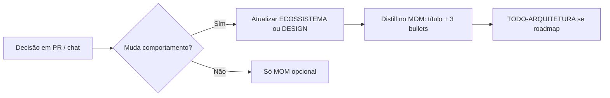

# MOM — memória para desenvolvimento e documentação

> **Escopo:** pasta `mom/` no repositório = [Memory Oriented Machine](https://github.com/momhq/mom) para **agentes que editam código e docs**.
>
> **Não é** o sistema de memória das partidas (isso é Qdrant + `SessionFact` + snapshot Redis — ver **ECOSSISTEMA.md** § memória).

---

## 1. Por que MOM existe neste repo

| Problema | Solução MOM |
|----------|-------------|
| Cada chat Cursor “esquece” decisões de arquitetura | Vault SQLite local persiste decisões |
| Docs vivos (`ECOSSISTEMA`, `DESIGN_FRONTEND`) mudam | MOM guarda *por que* mudou, não só o diff |
| Muitas skills/rules | MOM complementa com contexto de sessões longas de dev |

**Regra:** ao fechar uma decisão arquitetural importante, **resumir em MOM** e **refletir no doc vivo** — os dois juntos, não um ou outro.

---

## 2. O que NÃO fazer com MOM

| Errado | Certo |
|--------|-------|
| Chamar `mom_recall` no servidor durante `processPlayerTurn` | `recallSimilarMemories` + SQL facts |
| Substituir `ECOSSISTEMA.md` por memórias MOM | Doc vivo é fonte para humanos e PR |
| Indexar binários ou `.env` | Texto: decisões, convenções, links a seções dos docs |

---

## 3. Mapeamento MOM → runtime do jogo

| Princípio MOM | Runtime Crônicas |
|---------------|-------------------|
| Recall progressivo (restrito → amplo) | Facts por região/NPC → recall vetorial |
| Substância imutável | `SessionFact` append-only |
| Resumo curto + corpo longo | Ficha narrativa ~120 tokens + chunks Qdrant |
| Escopo de projeto | `sessionId` + filtro Qdrant |
| Curated vs rascunho | `isActive` em facts após validação |

---

## 4. Workflow recomendado para documentação



### Exemplo de memória MOM (conteúdo sugerido)

```
Título: P5 worker append-only
- executionSource worker não chama saveCombatEncounterState
- submitRollResult aplica post-roll só no sync
- Validar chaos:smoke check P5.2
Doc: ECOSSISTEMA § P5
```

---

## 5. Skills e rules que citam MOM

- Rule `dndai-documentation-hub.mdc` — aponta docs vivos + distinção MOM.
- Skill `dndai-documentation` — ao editar docs, não confundir domínios.

**Skills MOM upstream** (no repo `mom/skills/`): usar quando trabalhar *dentro* do fork MOM, não no gameplay.

---

## 6. Manutenção

| Evento | Ação |
|--------|------|
| Novo invariante P* | § em ECOSSISTEMA + nota MOM |
| Nova cor/token UI | DESIGN_FRONTEND + nota MOM se decisão de marca |
| Arquivar doc antigo | Só `docs/archive/`; nunca duplicar em MOM o texto inteiro |

---

*Fim — MOM para dev; jogadores usam Qdrant/SQL.*
