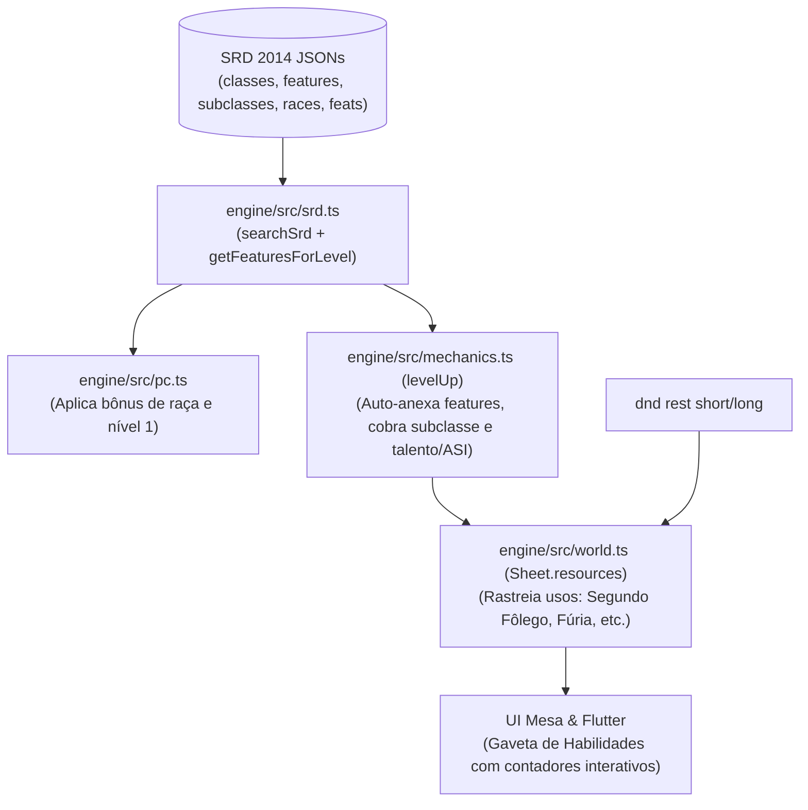

# Especificação Técnica: Expansão de Arquétipos, Talentos, Classes e Raças

> **Status:** Fases 1–4 implementadas em 12/10/2026, com os limites de automação descritos abaixo
> **Módulos impactados:** `engine/src/srd.ts`, `engine/src/rules.ts`, `engine/src/pc.ts`, `engine/src/mechanics.ts`, `engine/src/world.ts`, `engine/src/ops.ts`, `engine/src/cli.ts`, `app/lib/ui/fantasy/drawers.dart`, `mesa/src/components/panels/CharacterSheet.tsx`.

---

## 1. Diagnóstico do Estado Atual

Hoje, a ficha do personagem (`Sheet`) em [`engine/src/world.ts`](../engine/src/world.ts) armazena:
```typescript
export interface Sheet {
  race: string               // String livre ("Humano", "Elfo da Floresta")
  class: string              // Chave validada ("guerreiro", "mago", etc.)
  subclass: string           // String livre ("Campeão", "Evocador")
  level: number              // 1 a 20
  features: string[]         // Lista plana de strings ["Segundo Fôlego", "Surto de Ação"]
  // ... habilidades, perícias, slots de magia e dados de vida
}
```

### O que falta:
1. **O motor não consulta o banco SRD existente:** A pasta `data/srd/2014/normalized/` já possui os arquivos `features.json`, `subclasses.json`, `races.json`, `feats.json` e `traits.json`, mas [`srd.ts`](../engine/src/srd.ts) só indexa `monsters` e `spells`.
2. **Subida de nível passiva:** Em [`mechanics.ts:397`](../engine/src/mechanics.ts#L397), o motor emite a mensagem *"Registre novas habilidades de classe com update.features"*, delegando ao Mestre ChatGPT a tarefa manual de lembrar e cadastrar as habilidades de cada nível.
3. **Falta de recursos rastreáveis com recarga:** Habilidades com usos limitados (*Segundo Fôlego: 1/descanso curto*, *Surto de Ação: 1/descanso curto*, *Fúria: 2/descanso longo*, *Cura pelas Mãos: 5×nível PVs*) são tratadas como mero texto em `features`, sem controle de contador de usos.
4. **Sem suporte a Escolha de Subclasse / Talentos nos marcos de nível:** Nos níveis 3 (arquétipo) e 4, 8, 12, 16, 19 (ASI / Talento), o motor não valida escolhas nem aplica bônus automáticos.

---

## 2. Arquitetura da Solução



---

## 3. Detalhamento por Subsistema

### 3.1. Expansão do Módulo SRD (`engine/src/srd.ts`)
Expandir o catálogo de busca e utilitários de progressão:
* Permitir busca em: `"monsters" | "spells" | "features" | "subclasses" | "races" | "feats" | "traits"`.
* Expor via CLI:
  * `dnd srd feature <busca>` (ex: `dnd srd feature action-surge`)
  * `dnd srd subclass <classe>` (ex: `dnd srd subclass fighter`)
  * `dnd srd feat <busca>` (ex: `dnd srd feat grappler`)
  * `dnd srd race <busca>` (ex: `dnd srd race elf`)
* Função auxiliar `getFeaturesForLevel(cls: string, subclass: string | null, level: number): SrdFeature[]`:
  Retorna todas as características oficiais que um personagem dessa classe e arquétipo ganha no nível especificado.

### 3.2. Catálogo Oficial de Arquétipos SRD 2014
Para cada uma das 12 classes, mapear formalmente a subclasse SRD disponível:

| Classe | Arquétipo SRD | Nível de Escolha | Habilidades Notáveis |
| :--- | :--- | :---: | :--- |
| **Bárbaro** | *Caminho do Furioso (Berserker)* | 3º | Frenesi (3º), Fúria Sem Juízo (6º), Presença Intimidadora (10º) |
| **Bardo** | *Colégio do Conhecimento (Lore)* | 3º | Proficiências Bônus, Palavras Cortantes (3º), Magias Adicionais (6º) |
| **Clérigo** | *Domínio da Vida (Life)* | 1º | Discípulo da Vida (1º), Preservar a Vida (2º), Curandeiro Abençoado (6º) |
| **Druida** | *Círculo da Terra (Land)* | 2º | Truque Bônus e Recuperação Natural (2º), Caminho da Terra (6º) |
| **Guerreiro** | *Campeão (Champion)* | 3º | Crítico Aprimorado (3º - 19-20), Atleta Notável (7º), Estilo Adicional (10º) |
| **Monge** | *Caminho da Palma Aberta (Open Hand)* | 3º | Técnica da Palma Aberta (3º), Integridade Corporal (6º), Palma Trêmula (17º) |
| **Paladino** | *Juramento de Devoção (Devotion)* | 3º | Arma Sagrada (3º), Aura de Devoção (7º), Pureza de Espírito (15º) |
| **Guardião (Ranger)** | *Caçador (Hunter)* | 3º | Presa do Caçador (3º Colosso/Horda/Matador de Gigantes), Táticas Defensivas (7º) |
| **Ladino** | *Ladrão (Thief)* | 3º | Mãos Rápidas (3º), Gatuno (3º), Furtividade Suprema (9º), Usar Dispositivo (13º) |
| **Feiticeiro** | *Linhagem Dracônica (Draconic)* | 1º | Resiliência Dracônica (1º - CA 13+Des), Afinidade Elemental (6º), Asas (14º) |
| **Bruxo (Warlock)** | *O Corruptor (The Fiend)* | 1º | Bênção do Obscuro (1º - PVs temporários ao matar), Sorte do Obscuro (6º) |
| **Mago** | *Escola de Evocação (Evocation)* | 2º | Esculpir Magias (2º - aliados imunes à área), Truque Potente (6º), Potencializar (10º) |

### 3.3. Recursos Rastreáveis (`TrackedResource`)
Em vez de ter habilidades apenas como strings descritivas, introduzir recursos com recarga automática na ficha:

```typescript
export interface TrackedResource {
  id: string              // ex: "segundo-folego", "furia", "surto-de-acao", "cura-pelas-maos"
  name: string            // "Segundo Fôlego"
  max: number             // 1
  used: number            // 0
  resets_on: "short" | "long"
  effect?: string         // "Cura 1d10 + nível"
}
```

* **No Descanso Curto (`dnd rest short`):** Restaura todos os recursos com `resets_on: "short"`.
* **No Descanso Longo (`dnd rest long`):** Restaura todos os recursos (`short` e `long`).
* **Comando CLI / Mestre:**
  `dnd resource use <pc> <id>` ou no lote `apply`: `{"op": "resource.use", "who": "pc", "resource": "segundo-folego"}`.

### 3.4. Fluxo de Subida de Nível Aperfeiçoado (`dnd levelup`)
O comando `dnd levelup` passa a orquestrar a progressão completa:
1. **Verificação de Subclasse:**
   * Se a classe ganha subclasse no nível alcançado (nível 1, 2 ou 3) e `subclass` estiver vazio, o comando exige `--subclass <nome>` ou avisa as opções SRD disponíveis.
2. **Talentos e Aumento de Atributo (ASI nos níveis 4, 8, 12, 16, 19):**
   * O comando aceita:
     * `--asi <atributo+2 | at1+1,at2+1>` (ex: `--asi for+2` ou `--asi des+1,con+1`).
     * `--feat "<nome_do_talento>"` (valida pré-requisitos no `feats.json` (o snapshot SRD 2014 contém apenas Grappler; demais talentos do PHB não estão neste catálogo) e adiciona as vantagens na ficha).
3. **Anexação Automática de Características:**
   * Busca as features do novo nível no SRD e insere em `sheet.features`.
   * Se a feature for um recurso contável (ex: *Surto de Ação*), inicializa o `TrackedResource`.

### 3.5. Raças e Traços Raciais no `dnd pc create`
No momento da criação do personagem:
* Consultar `races.json` e `subraces.json`.
* Adicionar automaticamente os traços raciais (ex: *Visão no Escuro*, *Ancestralidade Feérica*, *Resiliência Anã*, *Sorte dos Halflings*) à lista de `features`.
* Validar que os bônus raciais de atributos (+2/+1) foram computados nos atributos declarados.

---

## 4. Impacto e Exibição nas Interfaces

### No App Flutter (`app/lib/ui/fantasy/drawers.dart`)
1. **Gaveta de Ficha / Habilidades:**
   * Dividir a aba em:
     * **Características Raciais** (com descrições em pergaminho).
     * **Habilidades de Classe & Arquétipo**.
     * **Talentos Adquiridos**.
2. **Recursos de Combate Ativos:**
   * Desenhar botões/marcadores rápidos para recursos com carga:
     * *Surto de Ação: [1/1]*
     * *Segundo Fôlego: [Usar]* (com efeito sonoro de cura e rolagem de 1d10 + nível).
     * *Fúria: [○○]* (bolinhas de ativação similares aos slots de magia).

### Na Mesa Web React (`mesa/src/components/panels/CharacterSheet.tsx`)
* Criar uma seção dedicada de **Recursos & Habilidades** com chips interativos e contadores de recarga (*"Descanso Curto"* / *"Descanso Longo"*).

---

## 5. Roteiro de Implementação Sugerido

1. **Fase 1 (SRD & CLI) — concluída:**
   * Atualizar `engine/src/srd.ts` para carregar `features.json`, `subclasses.json`, `feats.json` e `races.json`.
   * Adicionar os subcomandos `dnd srd feat|feature|subclass|race` em `cli.ts`.
2. **Fase 2 (Motor de Regras & Sheet) — concluída:**
   * Adicionar `resources: Record<string, TrackedResource>` em `Sheet` (`world.ts`).
   * Implementar `autoFeaturesForLevel` e comandos de consumo de recurso em `mechanics.ts` e `ops.ts`.
   * Integrar reset de recursos em `shortRest` e `longRest`.
3. **Fase 3 (Subida de Nível e Raças) — concluída:**
   * Enriquecer `dnd levelup` com flags `--subclass`, `--feat` e `--asi`.
   * Enriquecer `dnd pc create` para injetar traços raciais do SRD.
4. **Fase 4 (Interface do Jogador) — concluída:**
   * Adicionar gaveta/componente de Recursos e Talentos no Flutter e no React.

## 6. Entrega da Fase 1 (12/10/2026)

- CLI e conector consultam `monster|spell|feature|subclass|race|subrace|feat|trait`, sem exigir campanha. Nomes e índices seguem o catálogo em inglês; `srd subclass guerreiro` também aceita classes em português.
- `getFeaturesForLevel` consulta referências das tabelas `classes.levels` e `subclasses.levels`, evitando conceder automaticamente opções de estilos de luta. Valida nível 1–20 e vínculo entre classe e subclasse.
- A consulta não altera a ficha. Anexação automática, recursos, escolhas de subclasse/ASI/talento e interfaces de habilidades foram entregues na etapa descrita abaixo.
- Limites reais da fonte: 12 subclasses (uma por classe), Círculo da Terra para Druida e apenas o talento Grappler. Não há Círculo da Lua nem catálogo completo de talentos do PHB neste snapshot.

## 7. Entrega das Fases 2–4 (12/10/2026)

- `progression.ts` concentra progressão por tabela SRD, anexação de traços e características, recursos escaláveis e validação de escolhas. A ficha conserva `features` para compatibilidade e acrescenta `featureDetails`, `featureChoices`, `feats` e `resources`.
- `levelup` exige subclasse quando devida e ASI ou talento nos marcos oficiais, inclusive Guerreiro 6/14 e Ladino 10. Valida pré-requisitos, repetição e teto de 20. Aumento de Constituição aplica PV retroativos; Destreza respeita teto da armadura declarada. Erro desfaz toda a operação.
- `--choices` recebe JSON de escolhas de características: estilos de luta, terreno do Círculo da Terra, ancestral dracônico, Presa do Caçador, especialização em perícias, Metamagia, pacto e invocações. Nova característica com opções exige a escolha na subida. Invocações respeitam nível, magia conhecida e pacto; ao expandir, informe escolhas anteriores e novas. Trocas opcionais de invocações já escolhidas não fazem parte desta entrega.
- `pc create` injeta traços SRD da raça/sub-raça e características até o nível inicial. `abilities` continua sendo a ficha final; `base_abilities` opcional valida os bônus raciais (incluindo os dois +1 livres do meio-elfo), sem somá-los novamente. Raças próprias são preservadas e não recebem bônus inferidos. Escolhas iniciais omitidas são avisadas, exibidas e resolvidas por `feature choose`/`feature.choose`; nenhuma opção é escolhida automaticamente.
- Recursos: Segundo Fôlego, Surto de Ação, Indomável, Fúria, Cura pelas Mãos, Sentido Divino, Canalizar Divindade, Inspiração Bárdica, Ki, Integridade Corporal, Forma Selvagem e Pontos de Feitiçaria. A capacidade escala com classe/nível/atributo sem apagar usos gastos. Usos ilimitados no nível 20 são representados explicitamente.
- `resource use` e `resource.use` validam carga, quantidade, capacidade de agir e dados pendentes. Segundo Fôlego rola 1d10 + nível e cura; Cura pelas Mãos cura os pontos gastos; Integridade Corporal cura 3×nível. Os demais recursos controlam cargas, deixando seus efeitos contextuais ao Mestre. Não foi implementado um motor completo dos efeitos passivos de todas as características, talentos ou da economia de ações.
- Descanso curto restaura recursos curtos; longo restaura todos. Bardo muda para recarga curta no nível 5. A recarga de Ki pressupõe a meditação exigida pelo descanso.
- API autenticada `POST /api/resources` oferece consumo pelo jogador. Duas requisições concorrentes não gastam a mesma carga final duas vezes. Web e Flutter exibem contadores, descrições agrupadas, pontos selecionáveis, botões de uso e escolhas pendentes. Cura direta na UI é em si mesmo; outros alvos são conduzidos pelo Mestre via CLI/apply.
- Campanhas existentes não sofrem migração destrutiva. Os campos são enriquecidos em memória e salvos na próxima mutação, preservando características próprias. Recursos antigos sem histórico começam disponíveis. ASIs de níveis antigos não são inventados nem reaplicados.
