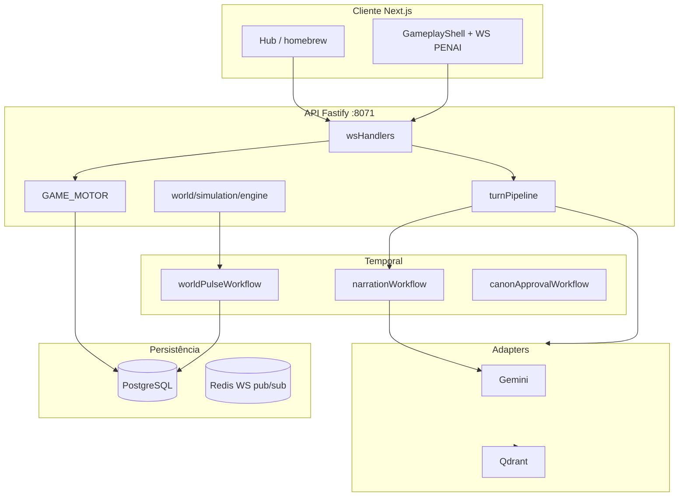

# Pacote de validação sênior — Crônicas de Aventuras

> **Para quem revisa arquitetura:** leia nesta ordem. Tudo foi escrito para refletir o código em **maio/2026** (estado real do sistema), não roadmaps antigos.
>
> **Envio sugerido:** estes 4 arquivos + `TODO-ARQUITETURA.md` (raiz) se quiser pendências.

| # | Documento | O que valida |
|---|-----------|--------------|
| 1 | **[ECOSSISTEMA.md](./ECOSSISTEMA.md)** | Motor PENAI, DM, IA Gemini, Temporal, WS v2, Postgres, Redis, Qdrant, RAG, homebrew, deploy |
| 2 | **[DESIGN_FRONTEND.md](./DESIGN_FRONTEND.md)** | UI v2, tokens WotC-adjacent, GameplayShell, pipeline visual do turno, homebrew UI |
| 3 | **[MOM_DESENVOLVIMENTO.md](./MOM_DESENVOLVIMENTO.md)** | MOM **só para dev/docs** (pasta `mom/`) — não é runtime da partida |
| 4 | **`TODO-ARQUITETURA.md`** (raiz) | Pendências e comandos operacionais |

**Nota:** `docs/archive/` foi removido do repositório; evitar ressuscitar documentação dispersa.

---

## Perguntas que esta revisão deve responder

1. O motor é realmente autoritativo e a IA não persiste mecânica em produção?
2. O worker pode correr em processo separado sem regravar combate/ficha?
3. Ações rápidas do jogador produzem narração obsoleta cancelada e `actionSequence` consistente?
4. O contrato WS (`contractVersion`, `actionCursor`, payloads) está claro para evoluir v2?
5. Memória (SQL + Qdrant + snapshot) tem fallback quando vetor cai?
6. Homebrew e traduções estão integrados de ponta a ponta ou só no CRUD?
7. A UI v2 comunica o split mecânico→narrativo ao jogador?

---

## Checklist PENAI (GameMaster greenfield)

### Motor e IA

- [ ] `GAME_MOTOR.validateAndApply` autoritativo — IA não persiste HP/inventário
- [ ] Adapters Gemini isolados em `GameMaster/adapters/` — domínio usa `defaultProviders`
- [ ] `turnPipeline` orquestrador enxuto (<120 linhas) — spawn/compactação fora
- [ ] `actionSense` heurísticas locais + Gemini opcional via adapter

### Mundo e simulação

- [ ] Event log + projector registry (`events/types.ts`, `EVENT_PROJECTORS`)
- [ ] `world/simulation/engine.tick()` — rumor, faction, npc, economy
- [ ] `entityLifecycle` pós-mecânico no WS (não no pipeline narrativo)
- [ ] GOAP para NPCs com `personality.planner = 'goap'`

### Memória e dados

- [ ] Três bancos lógicos: `globalMemory`, `sessionMemory`, `narrativeMemory`
- [ ] Qdrant via `adapters/qdrant/vectorStore.ts`; fallback SQL
- [ ] Postgres fonte da verdade; Temporal para narração/pulso/canon

### Homebrew e canon

- [ ] `validateModuleInstall` rejeita conflitos semver na instalação
- [ ] Canon: proposta → admin approve → `canonApprovalWorkflow`

### P7 — Survival Systems (campanha, não MMO)

- [x] Overlays `session_*` com `sessionId` + FK cascade — sem estado global cross-jogador
- [x] `entityTier` filtra GOAP (MAJOR+) e cap no `npcTick`
- [x] `campaignGc` arquiva INCIDENTAL idle; `WorldEntity` global intacto
- [x] Memory decay: `importanceScore`, recall exclui `decayedAt`
- [x] `CREATURE_SLAIN` altera `wolfStock`/preços na **mesma** sessão
- [x] Knowledge: combate social propaga `WITNESSED` para presentes
- [x] Quest avança via `questTick` sem ação do jogador
- [x] `sessionAggregate` snapshot em long-rest
- [x] UI aba **Campanha** expõe mood, quests, reputação (`GET /campaign`)
- [x] GC usa dias in-game (`lastSeenGameDay`); rumor popula `session_knowledge`
- [x] CI Postgres roda `penaiCampaignSurvival` integration

### P8 futuro (fora do escopo atual)

- [ ] `session_members` + WS party 4–5 jogadores

### P9 — Verdade consultável (mundo supremo fase 1)

- [x] `NarrativeContextDTO` no turno (`narrativeContextDto.ts`, `promptComposer.ts`)
- [x] Micro-pulso pós-mecânico (`microPulse.ts`, evento `MICRO_WORLD_TICK`)
- [x] Macro-pulso expandido (viagem, descanso, combate — não a cada turno)
- [x] `FACT_RECORDED` + proveniência (`provenanceMemory.ts`)
- [x] `FACTION_TICK` só via projector (ticks event-only)

### P10–P12 — Shard compartilhado e replay

- [x] Ticks simulação event-only + projectors (`REGION_MOOD_CHANGED`, `PRICE_CHANGED`, …)
- [x] `penai:replay-projectors` — reaplica projectors do event log
- [x] KG v2 alimentado por eventos (`kgProjector.ts`)
- [x] `world_shards` + `shardBackgroundWorkflow` (política regional compartilhada)
- [x] Campanha REST: `shard` + `timelineRecent` (`SharedWorldShardCard` UI)
- [x] `PENAI_NARRATION_TO_GLOBAL_RAG=false` (default) — narração não polui Qdrant global

### Bootstrap de sessão e SRD Docker

- [x] `worldBootstrapWorkflow` + `SessionWorldLoadingScreen`
- [x] Snapshot SRD via `requireSnapshotDir()` — compose monta `./data` em `/app/srd-data`
- [x] Seed PT-BR tolerante: aviso se snapshot ausente (`data-source.ts`)

---

## Checklist de validação (marcar na revisão)

### Arquitetura core (PENAI)

- [ ] `GAME_MOTOR.validateAndApply` autoritativo — IA não persiste HP/inventário
- [ ] Narração via Temporal `penai-narration` (ou síncrona se `TEMPORAL_DISABLED`)
- [ ] `submitRollResult` aplica pós-roll no motor; worker só narra
- [ ] `actionSequence` monotônico; `isStaleNarrationTurn` aborta fila obsoleta
- [ ] Worker Temporal separado: `npm run worker:temporal` quando `SKIP_TEMPORAL_WORKER=true`

### Dados e memória

- [ ] Postgres `game_sessions` + overlays `session_*` por campanha
- [ ] Qdrant via `adapters/qdrant/vectorStore.ts`; fallback SQL
- [ ] MOM **não** chamado em runtime de partida

### IA

- [ ] Gemini structured JSON; `GEMINI_MAX_ATTEMPTS=1`
- [ ] actionOptions do registry mecânico (default; LLM opcional)
- [ ] BYOK: `resolveGeminiApiKey` fail-closed sem billing de plataforma
- [ ] actionSense heurísticas locais + Gemini opcional via adapter

### Frontend

- [ ] Tokens `dnd.*` (ember/gold/obsidian)
- [ ] Fases PENAI: `idle` → `rolling` → `mechanical` → `narrating`
- [ ] **InputGate:** dock bloqueado em roll/narrating; bootstrap abertura liberado
- [ ] `latestActionSequenceRef` descarta WS antigo
- [ ] `dedupeSensoryTail` no `PenaiStoryFeed`

---

## Critérios de aceite (o que “passa” vs “não passa”)

### Aceite mínimo (para liberar staging)

- **Sem race mecânico:** nenhuma escrita de combate/ficha pelo worker em cenários de spam de ações/rolagens.
- **Ordem e cancelamento:** `actionSequence` monotônico; `narrationFailed` limpa loading; cliente não “volta no tempo”.
- **Degradação segura:** sem Redis/Temporal, narração inline ou erro explícito sem corromper estado.
- **Deploy split:** API + `worker:temporal` (ou `dev:all` Docker).

### Aceite para produção “de verdade”

- **Modelo estável:** sem depender de `:free` como default (ou com monitoração e fallback aceitos).
- **Métricas acionáveis:** `json_repair_alert` monitorado; plano para agregar consistência narrativa.
- **UI v2 dominante:** fluxo principal de mesa/hub não exige `UI_V2=false`.

---

## Diagrama de contexto (1 página)



---

## Plano de validação (procedimento recomendado)

> Objetivo: produzir evidência de que P4/P5 está blindado na prática, não só “parece certo no código”.

### 1) Sanidade de build/testes

```bash
npm run test --prefix backend
```

### 2) Invariantes distribuídas (P4/P5)

```bash
npm run chaos:smoke --prefix backend
```

### 3) Mesa rápida (manual, 2–3 minutos)

- Abrir sessão e executar 3 ações em sequência rápida (spam) e confirmar:
  - `mechanicalStateUpdate` chega antes da prosa
  - narração velha é cancelada (`narrationCancelled`) e não “pisa” no log final
  - `gameStateUpdate` antigo é ignorado (sequence)
- Forçar uma rolagem via dados 3D e confirmar:
  - pós-roll mecânico é aplicado antes da prosa
  - worker não duplica efeito mecânico

### 4) Split API/worker (dev ou docker)

Rodar API sem consumidor e worker separado; confirmar que o jogo continua funcional e a fila drena.

---

## Como dar feedback

| Severidade | Exemplo |
|------------|---------|
| **Bloqueante** | Worker ainda persiste HP; race não mitigada |
| **Alto** | Contrato WS ambíguo; sem métrica de consistência |
| **Médio** | Doc desatualizado vs código; UI legada confusa |
| **Baixo** | Typos, diagrama incompleto |

Atualize o doc correspondente (`ECOSSISTEMA` ou `DESIGN_FRONTEND`) no mesmo PR da correção de código.

---

*Índice da pasta docs: [README.md](./README.md)*
