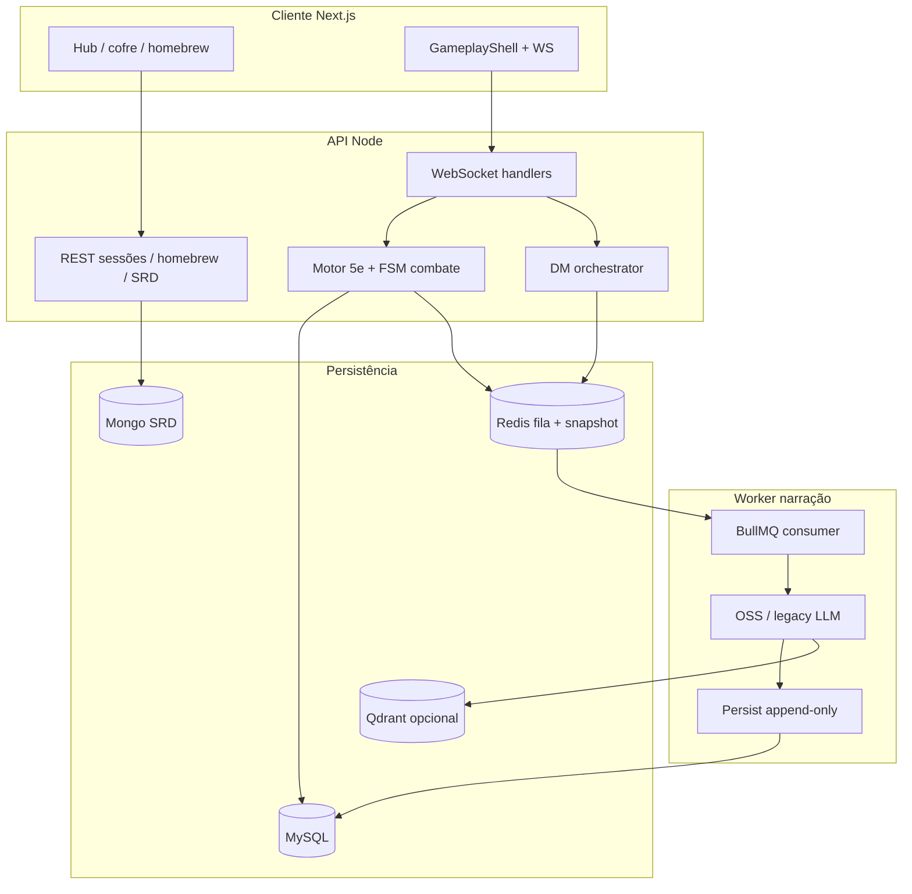

# Pacote de validação sênior — Crônicas de Aventuras

> **Para quem revisa arquitetura:** leia nesta ordem. Tudo foi escrito para refletir o código em **maio/2026** (estado real do sistema), não roadmaps antigos.
>
> **Envio sugerido:** estes 4 arquivos + `TODO-ARQUITETURA.md` (raiz) se quiser pendências.

| # | Documento | O que valida |
|---|-----------|--------------|
| 1 | **[ECOSSISTEMA.md](./ECOSSISTEMA.md)** | Motor, DM, IA/OSS, filas P4/P5, WS, MySQL, Redis, Qdrant, RAG, snapshot, homebrew, schemas, deploy |
| 2 | **[DESIGN_FRONTEND.md](./DESIGN_FRONTEND.md)** | UI v2, tokens WotC-adjacent, GameplayShell, pipeline visual do turno, homebrew UI |
| 3 | **[MOM_DESENVOLVIMENTO.md](./MOM_DESENVOLVIMENTO.md)** | MOM **só para dev/docs** (pasta `mom/`) — não é runtime da partida |
| 4 | **`TODO-ARQUITETURA.md`** (raiz) | Pendências e comandos operacionais |

**Nota:** `docs/archive/` foi removido do repositório; evitar ressuscitar documentação dispersa.

---

## Perguntas que esta revisão deve responder

1. O motor é realmente autoritativo e a IA não persiste mecânica em produção?
2. O worker pode correr em processo separado sem regravar combate/ficha?
3. Ações rápidas do jogador produzem narração obsoleta cancelada e `actionSequence` consistente?
4. O contrato WS (`contractVersion`, `actionCursor`, payloads) está claro para evoluir v2?
5. Memória (SQL + Qdrant + snapshot) tem fallback quando vetor cai?
6. Homebrew e traduções estão integrados de ponta a ponta ou só no CRUD?
7. A UI v2 comunica o split mecânico→narrativo ao jogador?

---

## Checklist de validação (marcar na revisão)

### Arquitetura core

- [ ] `narration_only` — campos mecânicos do LLM descartados antes de persistir
- [ ] `executionSource: worker` — `shouldSkipMechanicalPersistence` em combate/ficha
- [ ] `submitRollResult` aplica pós-roll no síncrono; worker só narra
- [ ] `actionSequence` incrementado no dispatch; stale abort no worker
- [ ] Idempotência `narration_completions` em retry BullMQ
- [ ] `SKIP_NARRATION_WORKERS` + container `narration-worker` no Compose

### Dados e memória

- [ ] SessionFact append-only; recall por região/NPC/quest
- [ ] Qdrant `session_memories` + backlog MySQL se embed falha
- [ ] Snapshot Redis com `gz1:` acima de ~2KB
- [ ] MOM **não** chamado em runtime de partida

### IA

- [ ] OSS minimal JSON + registry de `actionOptions`
- [ ] `json_repair_alert` em `/api/admin/ai-metrics`
- [ ] Consistência heurística sem retry LLM automático (custo)
- [ ] Risco documentado: `:free` + `OSS_MAX_API_ATTEMPTS=1` → fallback genérico

### Frontend

- [ ] Tokens `dnd.*` (ember/gold/obsidian) vs legado stone/amber
- [ ] `turnPipeline`: idle → rolling → mechanical → narrating
- [ ] **InputGate (BG3-like):** ações state-changing bloqueadas até `narrationComplete` (dock + free actions)
- [ ] `latestActionSequenceRef` descarta WS antigo
- [ ] Homebrew: instalar na sessão reflete em listas unificadas

---

## Critérios de aceite (o que “passa” vs “não passa”)

### Aceite mínimo (para liberar staging)

- **Sem race mecânico:** nenhuma escrita de combate/ficha pelo worker em cenários de spam de ações/rolagens.
- **Ordem e cancelamento:** `actionSequence` monotônico; `narrationCancelled` limpa loading; cliente não “volta no tempo”.
- **Degradação segura:** sem Redis, o sistema falha de forma explícita ou narra inline sem corromper estado.
- **Deploy split:** API sobe com `SKIP_NARRATION_WORKERS=true` e o worker consome a fila separadamente.

### Aceite para produção “de verdade”

- **Modelo estável:** sem depender de `:free` como default (ou com monitoração e fallback aceitos).
- **Métricas acionáveis:** `json_repair_alert` monitorado; plano para agregar consistência narrativa.
- **UI v2 dominante:** fluxo principal de mesa/hub não exige `UI_V2=false`.

---

## Diagrama de contexto (1 página)



---

## Plano de validação (procedimento recomendado)

> Objetivo: produzir evidência de que P4/P5 está blindado na prática, não só “parece certo no código”.

### 1) Sanidade de build/testes

```bash
npm run test --prefix backend
```

### 2) Invariantes distribuídas (P4/P5)

```bash
npm run chaos:smoke --prefix backend
```

### 3) Mesa rápida (manual, 2–3 minutos)

- Abrir sessão e executar 3 ações em sequência rápida (spam) e confirmar:
  - `mechanicalStateUpdate` chega antes da prosa
  - narração velha é cancelada (`narrationCancelled`) e não “pisa” no log final
  - `gameStateUpdate` antigo é ignorado (sequence)
- Forçar uma rolagem via dados 3D e confirmar:
  - pós-roll mecânico é aplicado antes da prosa
  - worker não duplica efeito mecânico

### 4) Split API/worker (dev ou docker)

Rodar API sem consumidor e worker separado; confirmar que o jogo continua funcional e a fila drena.

---

## Como dar feedback

| Severidade | Exemplo |
|------------|---------|
| **Bloqueante** | Worker ainda persiste HP; race não mitigada |
| **Alto** | Contrato WS ambíguo; sem métrica de consistência |
| **Médio** | Doc desatualizado vs código; UI legada confusa |
| **Baixo** | Typos, diagrama incompleto |

Atualize o doc correspondente (`ECOSSISTEMA` ou `DESIGN_FRONTEND`) no mesmo PR da correção de código.

---

*Índice da pasta docs: [README.md](./README.md)*
