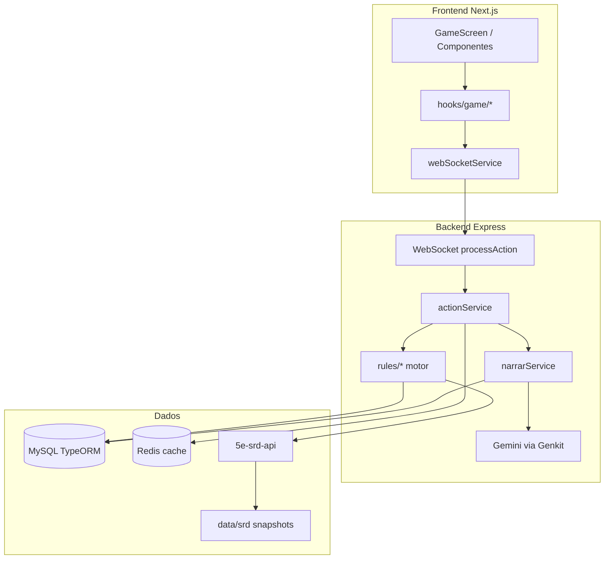

# Arquitetura — Crônicas de Aventuras

Documento atualizado na **Fase 7**. O blueprint legado está em [`archive/blueprint.md`](./archive/blueprint.md).

## Visão geral

## Pipeline de uma ação (WebSocket)

1. **Cliente** envia `processAction` com `intent` opcional, `prompt`, `clientStateVersion`, `actionId`.
2. **Motor** (`actionIntentService`) valida intent → `needs_roll` | `accepted` | `rejected`.
3. **Delta** aplicado em MySQL (`characterStateService`, inventário autoritativo).
4. **IA** (`narrarService`, modo `narration_only` por padrão) só narra; estado vem do DB.
5. **Resposta** via `actionResolution` + `gameStateUpdate`; cliente reconcilia por `stateVersion`.

## Camadas principais

| Camada | Pasta | Papel |
|--------|-------|--------|
| Frontend | `src/` | UI, `AuthGate`, hooks de jogo |
| API/WS | `backend/src/server.ts` | HTTP + WebSocket |
| Motor | `backend/src/rules/` | Regras 5e autoritativas |
| Narração | `backend/src/narration/` | Contexto, memória, bridge motor↔IA |
| Persistência | `backend/src/entities/` | TypeORM + migrações |
| SRD | `backend/src/services/srdApiAdapter.ts` | API local + snapshot offline |

## Infraestrutura local

- **`docker-compose.yml`**: MySQL, Redis, fork `5e-srd-api`, perfil `app` com backend/frontend.
- **Migrações**: `backend/src/database/migrations/` — produção com `DB_SYNC=false`.
- **CI**: `.github/workflows/ci.yml` — testes, lint, snapshot SRD.

## Variáveis críticas

| Variável | Uso |
|----------|-----|
| `NEXT_PUBLIC_WS_URL` | WebSocket do jogo |
| `SRD_API_BASE` | Fork 5e-srd-api |
| `DB_SYNC` | `true` só em dev (schema automático) |
| `REDIS_URL` | Cache; `mock` em testes |
