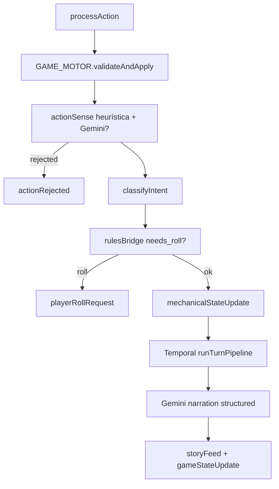

# Inteligência Artificial — Gemini PENAI

> **Última revisão:** 2026-06-06 · Ver `ECOSSISTEMA.md` §10, ADR `0001-action-sense-vs-motor.md`

## Resumo

- Produto default: **Gemini** via `GameMaster/adapters/gemini/*` e `config/aiProductDefaults.ts`.
- `AI_PIPELINE_MODE=narration_only` — LLM não altera HP, rolls ou inventário.
- **actionSense** (plausibilidade LLM) ≠ **motor** (rolagens/bloqueios SRD) — ver ADR 0001.
- Narração: structured JSON nativo (`responseJsonSchema` + Zod); action options via agente separado + registry mecânico.
- BYOK: `resolveInferenceApiKey` na narração, **actionSense** (free/social), actionOptions e bootstrap.
- **Uma tentativa por turno (jun/2026):** `GEMINI_MAX_ATTEMPTS=1`, `PENAI_NARRATION_MAX_ATTEMPTS=1`, Temporal `maximumAttempts: 1`; turnos obsoletos abortam em `isStaleNarrationTurn` sem LLM; `PENAI_ACTION_OPTIONS_LLM=false` (registry mecânico).

## Dois runtimes

| Runtime | Stack | Status |
|---------|-------|--------|
| **PENAI** | Postgres + Temporal + adapters Gemini | **Canônico** |
| **Legado Express** | MySQL + BullMQ + `ai/*` | Manutenção; wrappers deprecated |

Pastas históricas `ai-gemini/`, `ai-oss/` **não existem** — absorvidas em `GameMaster/`.

## Pré-LLM: três camadas

1. **Heurísticas** (`motor/actionSense.ts`) — meta-chat, física impossível, viagem inválida.
2. **Gemini árbitro** (`adapters/gemini/actionSense.ts`) — `{ acceptable, reason }` em intents `free`/`social`.
3. **Motor SRD** (`validateAndApply.ts`, `rulesBridge.ts`) — `needs_roll`, `rejected`, `accepted`.

| Saída motor | WS |
|-------------|-----|
| `rejected` | `actionRejected` |
| `needs_roll` | `mechanicalStateUpdate` + `playerRollRequest` |
| aceito | `mechanicalStateUpdate` → fila narração |

## Narração pós-ação

`engine/turnPipeline.ts`:

1. `buildNarrativeContextPack` + `recallMemoryForTurn`
2. `resolveInferenceApiKey` (BYOK ou plataforma)
3. `generateGeminiStructuredJson` — schema mínimo `{ narration, tone?, beat? }`
4. `assertNarrationPtBr`, `storeSessionMemory`
5. `suggestActionOptionsForTurn` (Gemini + fallback registry)
6. WS: `storyFeed` → `gameStateUpdate` → `narrationComplete`

## Structured output vs legado OSS

| Aspecto | Gemini PENAI | OSS legado |
|---------|--------------|------------|
| Contrato | `responseJsonSchema` nativo | JSON mode + repair |
| Reparo | `llmJsonTranslator` + Zod | `aiRepairUtils` |
| Action options | Registry + agente | JSON do modelo (proibido minimal) |

## Billing

- `buildAiAccessStatus`: `byok` | `platform_credits` | `unavailable`
- `consumePlatformNarrationCredit` por turno se `AI_PLATFORM_BILLING_ENABLED=true`
- Default produto: billing **desligado**

## Diagrama

## Arquivos-chave

| Path | Papel |
|------|-------|
| `GameMaster/adapters/gemini/*.ts` | Narration, actionSense, embeddings |
| `GameMaster/ai/geminiSchemas.ts` | JSON schemas |
| `GameMaster/engine/turnPipeline.ts` | Orquestrador turno IA |
| `ai/inferenceKeyResolve.ts` | BYOK |
| `services/aiBillingService.ts` | Créditos legado |
| `GameMaster/auth/penaiAiBillingService.ts` | Créditos PENAI |
| `narration/motorStateBridge.ts` | Strip campos mecânicos |
