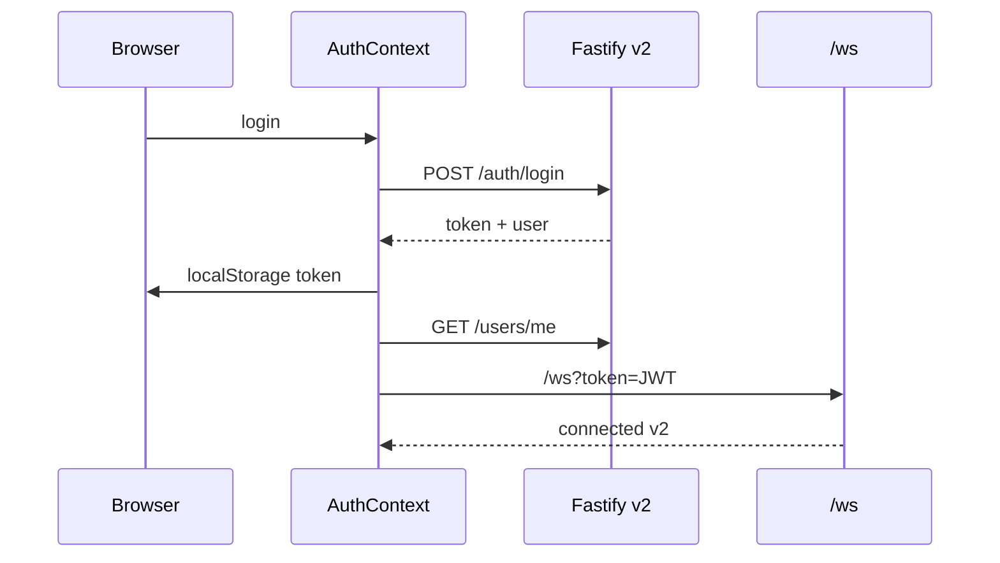

# Auth · Billing · BYOK · Onboarding

> **Última revisão:** 2026-06-06 · Ver `ECOSSISTEMA.md` §19

## Resumo

- Contas em **PostgreSQL** `penai_users` — rotas `/api/v2/auth/*`, `/api/v2/users/*`.
- JWT `{ userId }`, 7 dias, chave `localStorage['token']` (`src/lib/authToken.ts`).
- WS: `/ws?token=JWT` — `verifyWsToken` em `app/plugins/auth.ts`.
- BYOK Gemini (`AIza…`) em DB + `dndai_gemini_byok_key` local; OpenRouter só legado OSS.
- Gate produto: login → licença → `canInfer` → onboarding.

## Fluxo HTTP

1. `POST /api/v2/auth/login` → JWT
2. Cliente persiste `token`
3. `GET /api/v2/users/me` → perfil + `aiAccess` + licença + `onboardingCompleted`
4. `apiClient` injeta `Authorization: Bearer` (rotas não públicas)

## WebSocket

- URL: `buildPenaiWsUrl(token)` → `{origin}/ws?token=…`
- Handshake: `{ type: 'connected', contractVersion: 2, locale: 'pt-BR', engine: 'penai' }`
- **Gap P1:** `resolveWsUserId` aceita `?userId=` sem JWT (dev only)

## BYOK e créditos

| Modo | Condição |
|------|----------|
| `byok` | Chave usuário ou billing off + chave servidor |
| `platform_credits` | Billing on + créditos > 0 |
| `unavailable` | Sem via de inferência |

Env: `AI_PLATFORM_BILLING_ENABLED` (default **false**), `AI_INCLUDED_CREDITS_DEFAULT` (default 30 no registro).

Consumo: `consumePenaiNarrationCredit` em `turnPipeline.ts` por turno narrado.

## Onboarding

- Flag: `settings.onboardingCompleted`
- UI: `ProductOnboarding` — steps welcome → ai_access → create_hero → play
- API: `POST /api/v2/users/me/onboarding/complete`

## Endpoints principais

| Método | Path | Notas |
|--------|------|-------|
| POST | `/api/v2/auth/register` | username, email, password |
| POST | `/api/v2/auth/login` | login = email ou username |
| GET | `/api/v2/users/me` | Sem `apiKey` na resposta |
| PUT | `/api/v2/users/me/settings` | PATCH parcial incl. `apiKey` |
| POST | `/api/v2/users/me/onboarding/complete` | |
| POST | `/api/v2/licenses/activate` | `{ key }` |

> **Legado MySQL** (`authService.ts`, entidade `User`) — **não** usado pelas rotas v2.

## Diagrama

## Arquivos-chave

| Path | Papel |
|------|-------|
| `GameMaster/auth/penaiAuthService.ts` | Login/registro |
| `GameMaster/auth/penaiUserService.ts` | Perfil/settings |
| `app/plugins/auth.ts` | JWT + verify WS |
| `src/contexts/AuthContext.tsx` | Sessão frontend |
| `src/lib/authToken.ts` | Chave única `token` |
| `src/components/settings/AiBillingSection.tsx` | BYOK UI |
