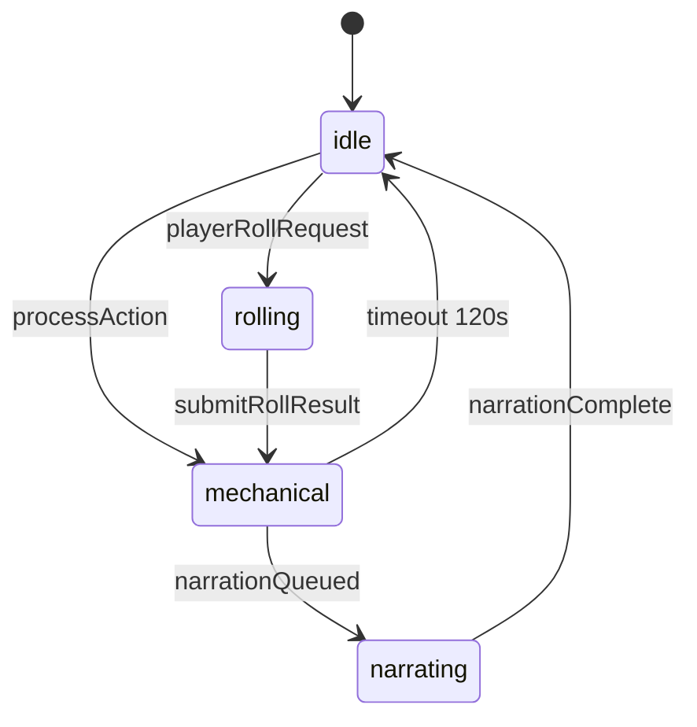

# Frontend — Turn Pipeline · GameplayShell · WS

> **Última revisão:** 2026-06-06 (death saves + game over) · Ver `DESIGN_FRONTEND.md` §7–8

## Resumo

- Mesa V3 **PENAI-only:** `usePenaiTurnPipeline` + `PenaiGameplayProvider`.
- Fases: `idle` → `rolling` → `mechanical` → `narrating` — store em `turnPipelineStore.ts`.
- `GameplayShell` = layout puro; crônica via `PenaiStoryFeed` (não `NewNarrativeLog`).
- Bootstrap abertura: `sessionStorage` `cda:session:{id}:penaiOpening`.
- `dedupeSensoryTail` existe em `narrationText.ts` mas **não wired** no feed (gap P2).

## Fases do turno

| Fase | Gatilho | UX |
|------|---------|-----|
| `idle` | `narrationComplete`, falha, timeout 120s | Dock liberado |
| `rolling` | `playerRollRequest` | `DiceRollModal`, gate `LOCKED_ROLLING` |
| `mechanical` | `processAction`, `mechanicalStateUpdate` | Overlay motor; `PenaiMechanicalSync` |
| `narrating` | `narrationQueued`, `storyFeedReplay` com `pendingNarration`, ou `sendProcessAction` bootstrap | Banner Temporal; gate `LOCKED_NARRATING` exceto bootstrap |

**Bootstrap:** `bootstrap: true` seta `narrationPending` + fase `narrating` (spinner no log), mas `InputGate` permanece `OPEN` via `bootstrapPendingRef`. **Reconnect:** `storyFeedReplay` com `pendingNarration: true` trava o dock (`LOCKED_NARRATING`). **Falha na abertura:** limpa `sessionStorage` `penaiOpening` + botão manual `retryOpening` (sem retry automático de LLM).

## Camadas de estado

| Camada | Papel |
|--------|-------|
| `PenaiGameplayContext` | WS ao vivo: feed, phase, mechanical |
| `GameStateContext` | Ficha, combate, modais |
| `turnPipelineStore` | Pub/sub fase + InputGate |
| `penaiBridge` | `sendProcessAction` / `submitRollResult` imperativo |

## Eventos WS (handler)

- `isStaleSequence` descarta `actionSequence < latest`
- `connected` valida `contractVersion >= 2`, locale `pt-BR`
- `narrationFailed` / `actionRejected` → `penai-turn-settled`
- `heroPermanentlyDead` → `gameOver` no hook + `LOCKED_UNCONSCIOUS` + overlay `HeroDeathScreen`

## Vitals inconsciente / game over

| Sinal | Fonte | UX |
|-------|-------|-----|
| `deathSaves` / `heroStatus` | `mechanicalStateUpdate.character` | `PenaiMechanicalSync` → ficha; `HeroDeathSavesBanner` no log |
| Inconsciente @ 0 HP | `setVitalsInputSignals` | `LOCKED_UNCONSCIOUS` no dock (death save tem prioridade via `LOCKED_ROLLING`) |
| `heroPermanentlyDead` | WS | `gameOver` em `usePenaiTurnPipeline`; APIs `export-hero-to-vault` / `reset-progress` |

## sessionStorage

| Chave | Propósito |
|-------|-----------|
| `cda:session:{id}:penaiOpening` | Evita reenviar abertura |
| `cda:session:{id}:penaiBootstrap` | Fallback startGame |
| `dndai:session-opened:{id}` | Sessão aberta na aba |

## Diagrama state machine

## Componentes e hooks

| Peça | Responsabilidade |
|------|------------------|
| `GameplayShell` | Layout mesa 62/38, mobile tabs |
| `GameplayScreen` | Orquestra bootstrap + WS + modais |
| `PenaiStoryFeed` | Crônica, TTS, spinner Temporal |
| `GameplayActionDock` | Ações + overlay gate |
| `PenaiMechanicalSync` | PATCH ficha/combate |
| `usePenaiTurnPipeline` | WS lifecycle, fases, feed |
| `useInputGate` | Bloqueio input dock |
| `authToken.ts` | JWT chave `token` |

## Legado

Slices `useGameNarrationSlice` / `isLoading` coexistem para labels; **autoridade de fase = PENAI hook**. Preferir `useInputGate()` sobre `setIsLoading` disperso.
