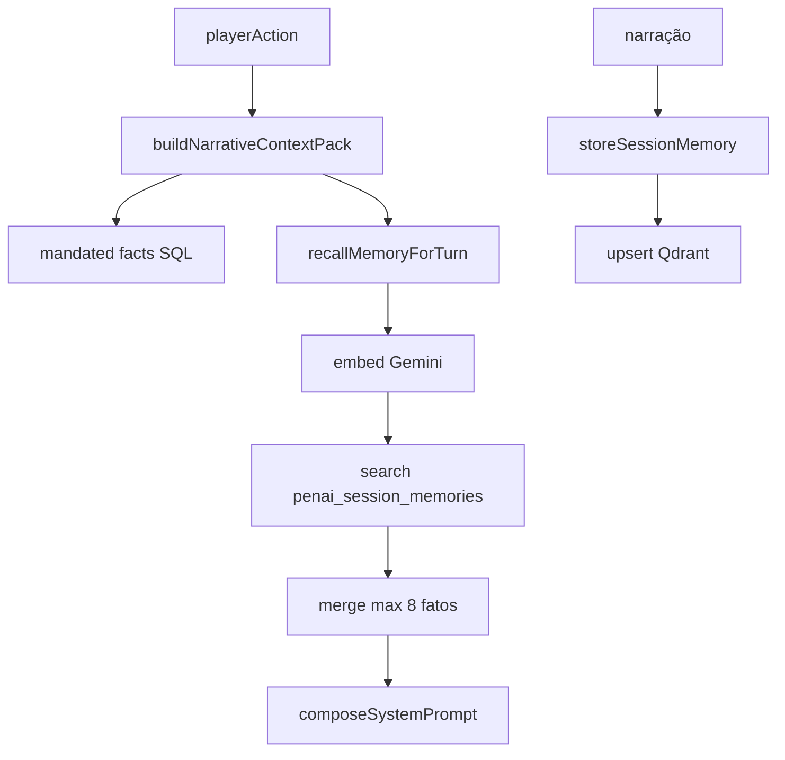

# Memória de partida · RAG · Qdrant

> **Última revisão:** 2026-06-06 · **Não confundir** com MOM dev (`mom/context/`)

## Resumo

- **Dois stacks:** PENAI (Postgres + `penai_*` Qdrant) **ativo**; MySQL legado (`SessionFact`, `session_memories`) mantido, turno órfão.
- Embeddings produção: **Gemini `gemini-embedding-001`** — não OpenRouter (drift doc antiga).
- Recall progressivo: fatos mandatados → embed query → Qdrant → merge max 8 fatos.
- Escrita pós-narração: `storeSessionMemory` + opcional RAG global + compaction Temporal.
- Snapshot Redis (`gz1:`) só via path legado órfão — PENAI não usa.

## PENAI — leitura (pré-narração)

`recallMemoryForTurn` em paralelo:

1. `recallSessionMemory` — embed `playerAction` → search `penai_session_memories`
2. `recallGlobalMemory` — `penai_world_memories`
3. `recallNarrativeSummary` — Postgres `NarrativeSummary`

`buildNarrativeContextPack` mescla: knowledge graph, mandated facts, quests, pulso, timeline.

## PENAI — escrita (pós-narração)

`turnPipeline.ts`:

1. `storeSessionMemory` → Postgres + upsert Qdrant
2. `appendWorldEvent` — `NARRATION_COMPLETED`
3. `recordProvenanceFact` — tags `[FATO]`
4. `maybeScheduleMemoryCompaction` — ~8 turnos

Env: `PENAI_NARRATION_TO_GLOBAL_RAG` (default false).

## SessionFact (MySQL legado)

- Append-only `session_facts`; TTL por tier (ephemeral 4h, scene 48h, persistent ∞)
- `queryRelevantFacts` — REST campanha + snapshot; **não** no turno PENAI
- `recordMotorFact` — transições região (motor legado)

## Coleções Qdrant

| Coleção | Stack |
|---------|-------|
| `penai_session_memories` | PENAI ativo |
| `penai_world_memories` | Canon global PENAI |
| `session_memories` | Legado MySQL |

Distância Cosine; `QDRANT_VECTOR_SIZE` default 2048.

## Diagrama

## Arquivos-chave

| Path | Quando |
|------|--------|
| `GameMaster/memory/recallMemoryForTurn.ts` | Pré-narração |
| `GameMaster/memory/storeSessionMemory.ts` | Pós-narração |
| `GameMaster/adapters/gemini/embeddings.ts` | Embed produção |
| `services/vectorMemoryService.ts` | Legado órfão turno |
| `services/sessionFactService.ts` | MySQL facts |
| `services/narrativeSnapshotService.ts` | Redis gz1 legado |
