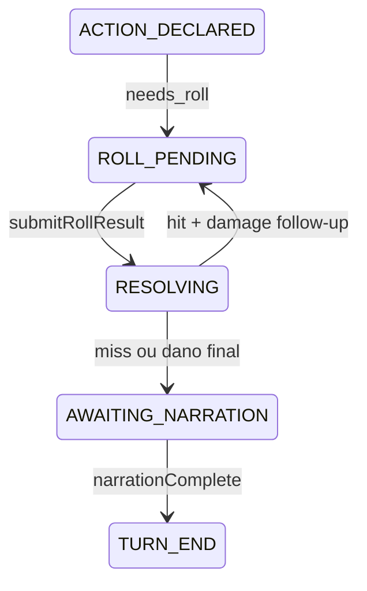

# Motor D&D 5e · Combate FSM · Camada DM

> **Última revisão:** 2026-06-06 · Ver `ECOSSISTEMA.md` §6–7

## Resumo

- Regras SRD puras em `backend/src/rules/`; orquestração em `GameMaster/motor/`.
- Split mecânico×narrativo: motor síncrono no WS → narração só após rolls resolvidos.
- FSM combate: 10 fases; só motor avança — IA nunca chama `setPenaiCombatPhase`.
- Roll chain: hit ataque → damage follow-up (`shouldNarrate: false` no hit).
- DM pré-LLM: `actionSense` + `classifyIntent` (PENAI); `dmTurnOrchestrator` (legado).

## Camadas do motor

| Camada | Pasta | Papel |
|--------|-------|-------|
| Regras SRD | `rules/` | Ataque, perícia, magia, dano |
| Bridge | `motor/rulesBridge.ts` | RuleCheck → PlayerRollRequest |
| Orquestrador | `motor/validateAndApply.ts` | Entrada WS |
| Roll | `motor/rollPipeline.ts` | Rolagem autoritativa servidor |
| Combate | `GameMaster/combat/engine.ts` | Postgres encounter |

## RuleCheckResult → WS

| Status | WS |
|--------|-----|
| `needs_roll` | `mechanicalStateUpdate` + `playerRollRequest` |
| `accepted` | `mechanicalStateUpdate` → narração |
| `rejected` | `actionRejected` |

## FSM combate

Fases: `IDLE` → `ENCOUNTER_ACTIVE` → … → `ROLL_PENDING` ↔ `RESOLVING` → `AWAITING_NARRATION` → `TURN_END`.

- `advancePenaiCombatPhaseAfterRoll` após `submitRollResult`
- Follow-up roll mantém `ROLL_PENDING` sem narrar no meio da cadeia
- Gate narração: `shouldAllowPenaiCombatNarration`

## Split mecânico × narrativo

```
processAction → validateAndApply → mechanicalStateUpdate
  → [awaitingRoll] playerRollRequest
  → submitRollResult → resolveRoll (servidor rola)
  → [chain] novo playerRollRequest
  → queueNarration → worker → gameStateUpdate
```

## Camada DM

| Path | Módulos |
|------|---------|
| PENAI | `actionSense.ts`, `classifyIntent.ts`, `freeActionClassifier.ts` |
| Legado | `dmTurnOrchestrator.ts`, `skillActionSemantics.ts` |

Env: `DM_AUTO_ROLL`, `DM_LLM_CLASSIFY`, `DM_CLASSIFY_FREE_ACTION`.

## Diagrama FSM + roll chain



## Arquivos-chave

| Path | Papel |
|------|-------|
| `GameMaster/motor/validateAndApply.ts` | Hot path |
| `GameMaster/motor/rollPipeline.ts` | Resolve roll |
| `combat/combatPhase.ts` | FSM fases |
| `combat/phaseGate.ts` | Gates narração |
| `rules/rollResolutionCore.ts` | Hit/damage chain |
| `services/dm/dmTurnOrchestrator.ts` | Legado Express |
