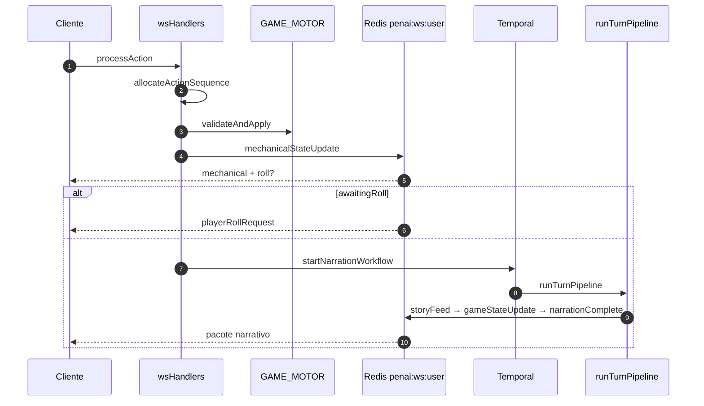

# WebSocket · Action Pipeline · Temporal

> **Última revisão:** 2026-06-06 · Runtime: PENAI · Ver também `ECOSSISTEMA.md` §8–9

## Resumo

- WS em `GET /ws?token=<JWT>` — contrato **V2** (mensagens planas, `contractVersion: 2`, `locale: pt-BR`, `engine: penai`).
- `processAction` aloca `actionSequence`, roda motor síncrono, emite `mechanicalStateUpdate`, enfileira narração via Temporal (`penai-narration`).
- Worker separado publica WS via **Redis pub/sub** (`penai:ws:user`) — substitui relay legado `wsUserRelay`.
- Turn lock impede ações concorrentes enquanto `actionSequence > actionCursor`.
- Stack BullMQ (`SKIP_NARRATION_WORKERS`, `worker:narration`) **não** é lido por `penaiServer.ts` — legado.

## Handler principal

`backend/src/GameMaster/transport/wsHandlers.ts` — `handleProcessAction`

| Etapa | Módulo | Comportamento |
|-------|--------|---------------|
| Auth | `wsHandlers` + `wsPubSub.registerLocalSocket` | JWT query; sockets por `userId` |
| Turn lock | `motor/turnLock.ts` | Bloqueia roll pendente ou cursor atrasado |
| Sequence | `sessions/sessionService.ts` | `GameSession.actionSequence += 1` antes do motor |
| Motor | `GAME_MOTOR.validateAndApply` | Persiste regras; pode `awaitingRoll` |
| Delta WS | `emitMechanicalUpdate` | `mechanicalStateUpdate` + `gameStateUpdate` mecânico |
| Fila | `temporal/client.ts` | `startNarrationWorkflow` ou síncrono se `TEMPORAL_DISABLED` |
| Worker | `temporal/activities/runTurnPipeline.ts` | Gemini → `storyFeed` → `gameStateUpdate` → `narrationComplete` |

## Relay Redis (substitui wsUserRelay)

| Processo | Relay |
|----------|-------|
| API (`penaiServer.ts`) | `startWsPubSubSubscriber()` subscreve `penai:ws:user` |
| Worker (`worker:temporal`) | Publica via `publishWsToUser`; sem sockets locais |
| Sem Redis (`REDIS_URL=mock`) | `deliverLocal` direto — só no processo com sockets |

Implementação: `GameMaster/transport/wsPubSub.ts` — envelope `{ userId, payload }`.

## Variáveis de ambiente

| Variável | Efeito |
|----------|--------|
| `SKIP_TEMPORAL_WORKER` | API não embute worker Temporal |
| `TEMPORAL_DISABLED` | Narração síncrona (testes) |
| `TEMPORAL_ADDRESS` / `TEMPORAL_NAMESPACE` | Default `localhost:7233` / `penai` |

## Invariantes

1. Mecânica **sempre** síncrona no handler WS antes de enfileirar narração.
2. `actionSequence` monotônico; cliente descarta WS stale (`latestActionSequenceRef`).
3. Worker narrativo **não** re-aplica combate/ficha.
4. Ordem narrativa: `storyFeed` → `gameStateUpdate` → `narrationComplete`.

## Diagrama

## Arquivos-chave

| Path | Responsabilidade |
|------|------------------|
| `GameMaster/transport/wsHandlers.ts` | Handlers WS v2 |
| `GameMaster/transport/wsPubSub.ts` | Relay Redis |
| `temporal/client.ts` | Enfileiramento workflow |
| `temporal/workflows/narrationWorkflow.ts` | Contrato fila |
| `engine/turnPipeline.ts` | Pipeline narrativo worker |
| `temporalWorkerMain.ts` | Processo worker dedicado |
